# Hot Cargo

A career mod for [Cosmoteer](https://store.steampowered.com/app/799600/Cosmoteer_Starship_Architect__Commander/) that turns the open-ended career into a short, tense run, like FTL.

You stole corporate tech, and the corporation wants it back. Haul it across about 8 systems to the Buyer at the edge of the map. Every minute you stay, the heat rises and the hunters get closer. Sell a unit to buy a better ship, or hold it all for a bigger score. Talk your way past a hunter, hire a mercenary, or hide your tech on a friendly freighter.

Vanilla Cosmoteer lets you build forever. Hot Cargo gives you a goal, a clock and an enemy that learns where you are. A run takes 2 to 3 hours, alone or in co-op.

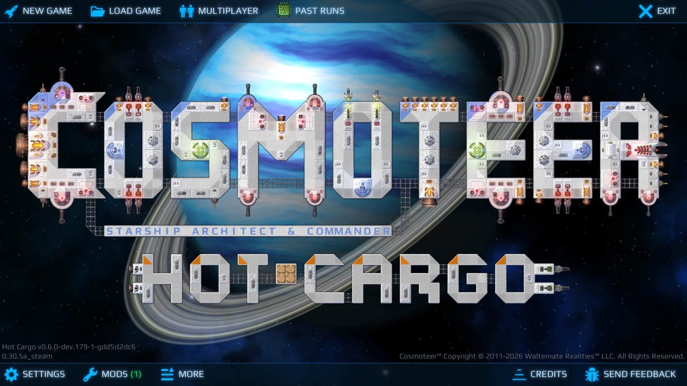
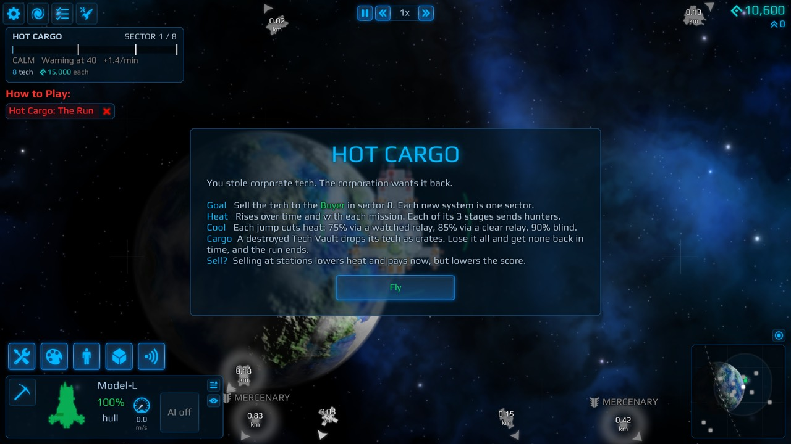
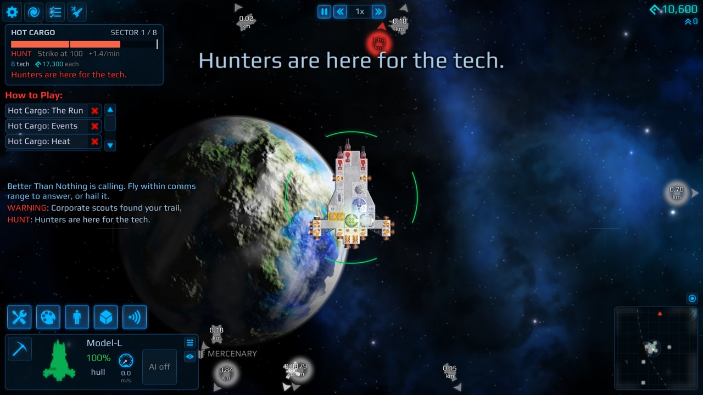
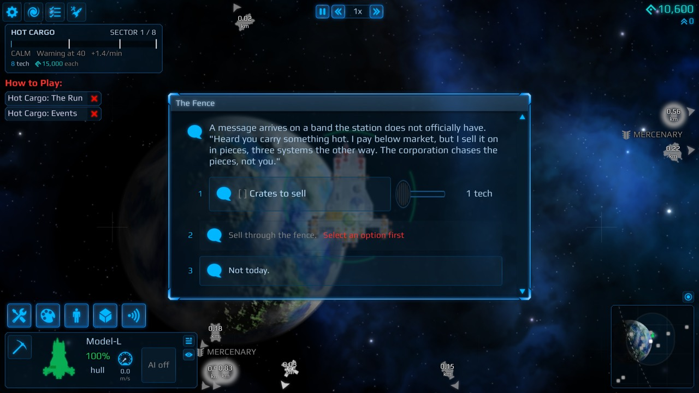

## How a run plays

- **Hold or sell.** You start with 8 Stolen Tech in Tech Vaults. The more you hold, the harder the corporation hunts you. Stations buy tech, and the price rises during the run. The Buyer pays 4×, and every unit you still hold counts in the score.
- **Move on or burn.** Heat rises with time and with every mission. Each heat stage sends hunters. A jump to a new system cools you down.
- **Protect the cargo.** Tech lives in real parts of your ship. A destroyed vault spills crates that hunters grab. Lose all your tech and the run ends.
- **Deliver.** The Buyer waits in the last sector. Sell it your tech to win.

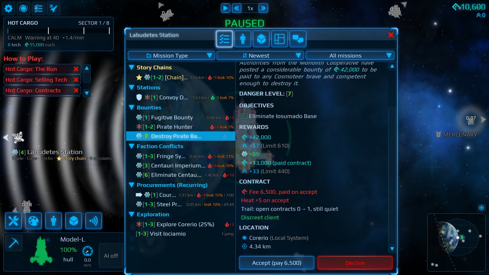
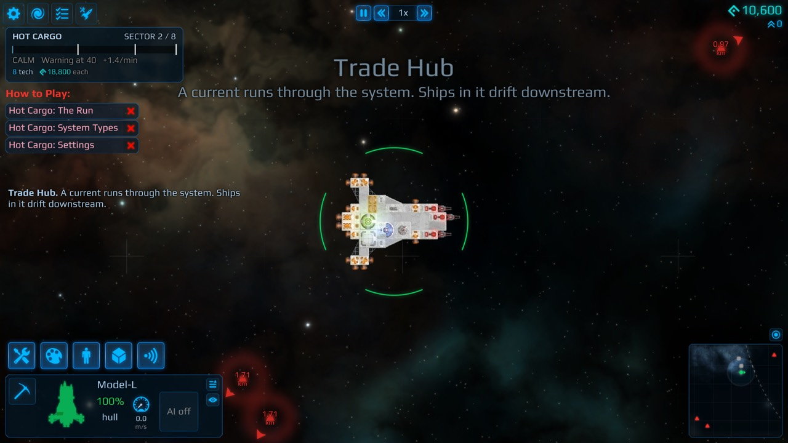
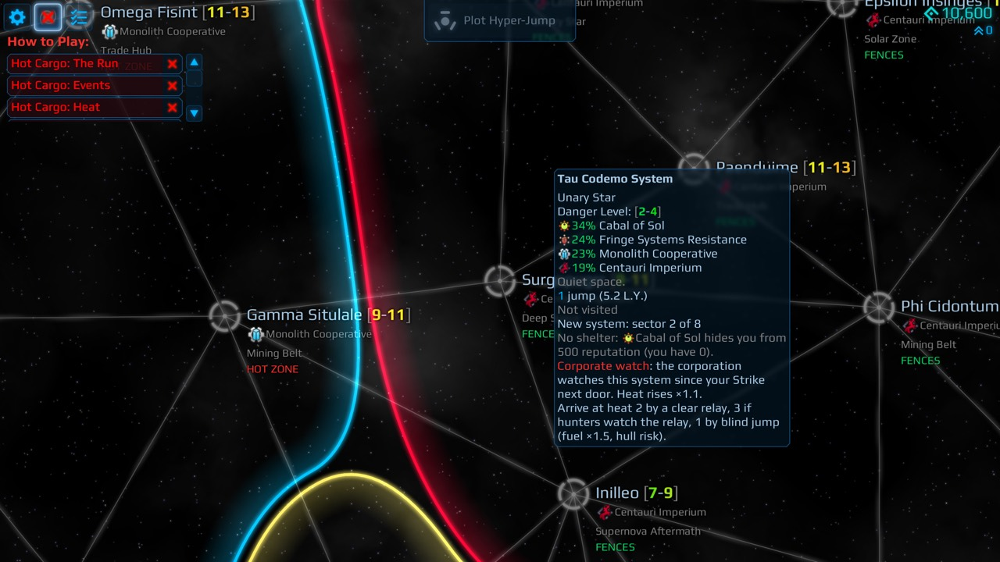
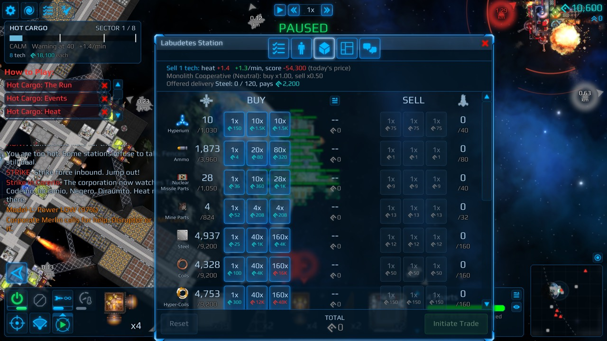
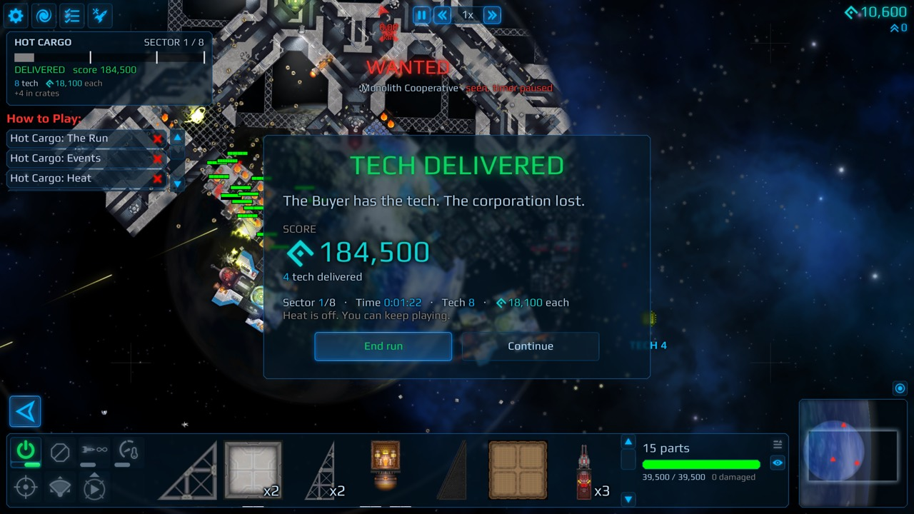
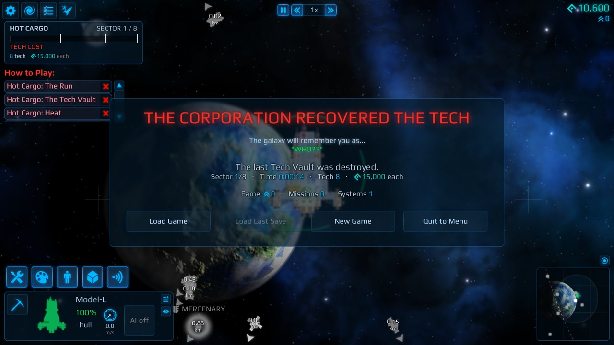

## Features

Click a feature to open it.

### The heat and the hot cargo

<b>Heat and hunter waves</b>: stay too long and the corporation sends ships

Heat rises every minute and with every mission you finish. At each heat stage the corporation reacts: first scouts, then a hunter pack, then a strike force that arrives in waves until you leave. A red strip in the heat panel and an alarm tell you when a stage starts. Holding more tech makes the heat rise faster.

Spec: [Heat](spec/09-heat.md), [Corporate response](spec/10-corporate-response.md), [Strike waves](spec/23-strike-waves-and-enemy-ai.md)

<b>Tech Vaults</b>: your cargo is a part of your ship, and it can be shot off

Tech lives in Tech Vaults, small armored parts that you place, protect and spread out. Hits do not cost tech, but a destroyed vault spills its tech as crates, and some of it burns. Hunters go for your vaults and grab loose crates. A gold outline shows where your vaults are, and map blips show where tech is in the system. If you hold no tech for 3 minutes, the run is lost.

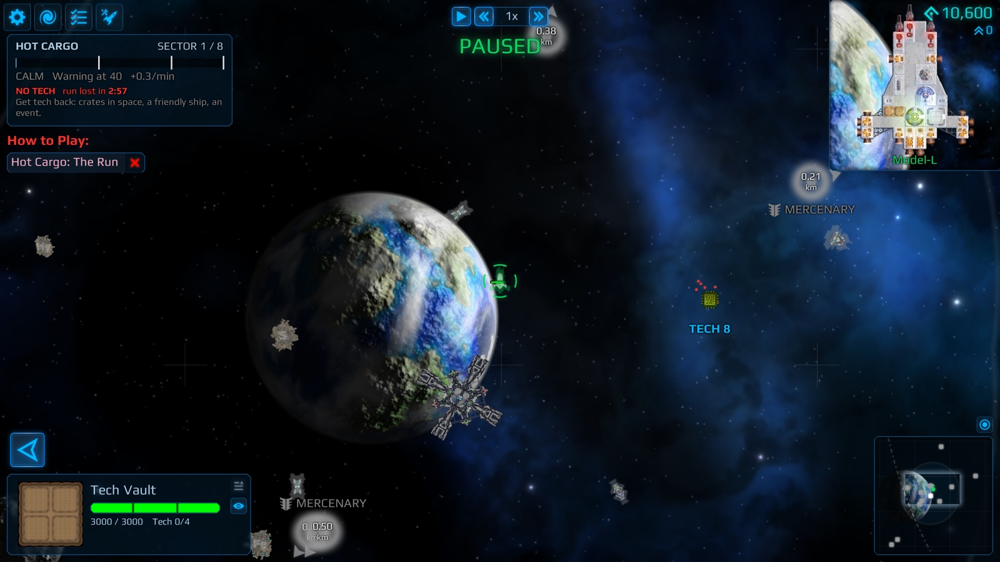

Spec: [Tech units and the Tech Vault](spec/07-tech-units-and-the-tech-vault.md), [One-tile Tech Vault](spec/39-one-tile-tech-vault.md)

<b>Sell now or deliver later</b>: one unit buys a ship, but every sale lowers your score

Any trade station buys tech, and the price rises with time, danger and your notoriety. One or two units pay for a ship that keeps up with the hunters. The Buyer pays 4×, and unsold units count the same in the score. The trade tab shows what a sale does to your heat and your score before you sell. You can buy back tech that you sold, at a markup.

Spec: [Tech value and selling](spec/08-tech-value-and-selling.md), [Win and loss](spec/06-win-and-loss.md)

<b>Jumps cool you down</b>: reach a quiet relay first

Every jump to another system leaves most of the heat behind. A relay with no hunter near it cuts more heat than a watched one. Ships that cannot make the jump get a warning before you leave, so nobody is stranded by surprise. Tech that stays behind is lost, and the jump dialog says how much before you go.

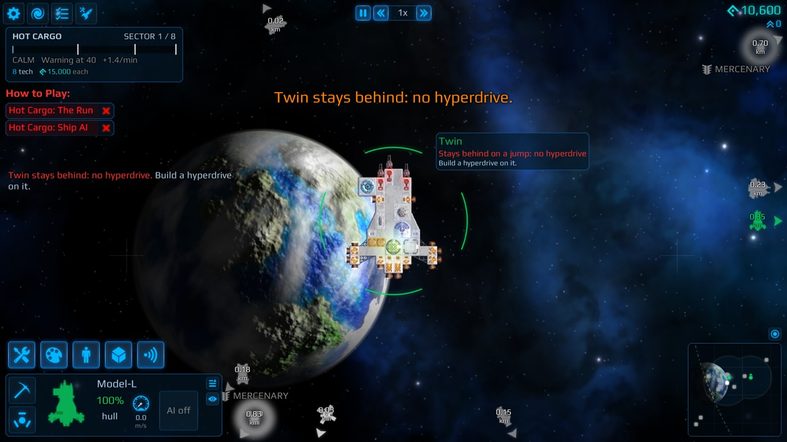
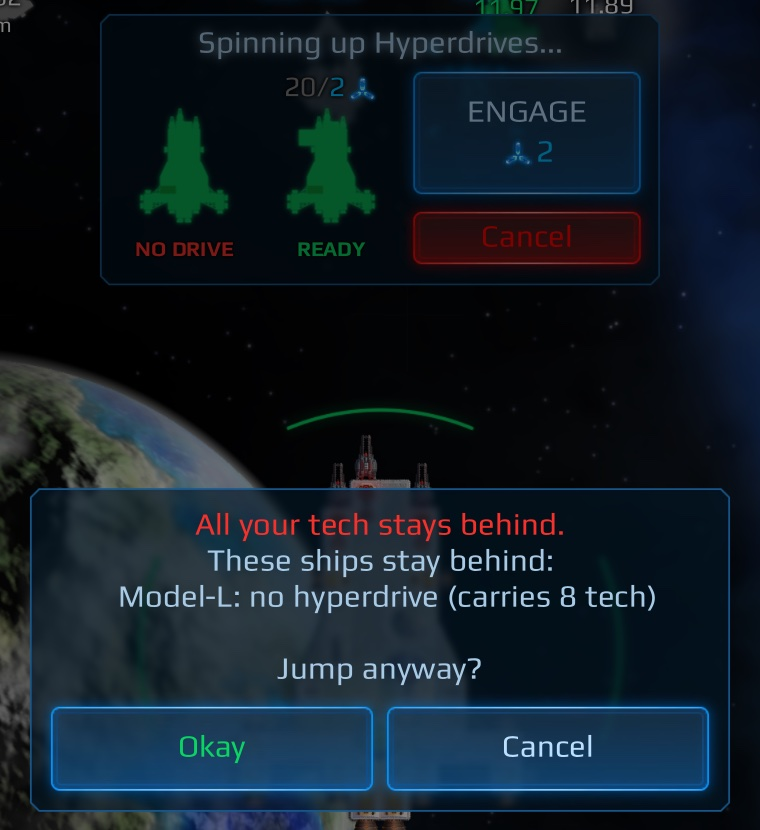

Spec: [Factions, jumps and station prices](spec/38-factions-jumps-and-station-prices.md), [Jump warnings](spec/58-jump-warnings.md)

<b>Tech outside a vault decays</b>: stash it anywhere, but not for long

Normal storage takes tech too, but there it breaks down in 6 minutes. The part card and the map blips mark decaying tech. Build more vaults, or sell before it is gone.

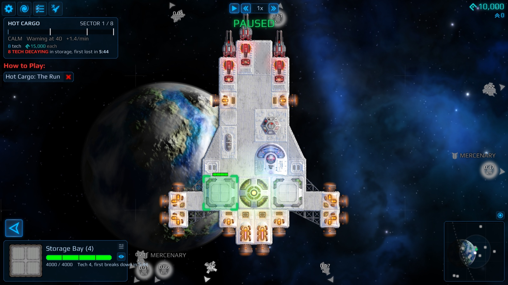

Spec: [Tech in storage and decay](spec/60-tech-in-storage-and-decay.md)

<b>Bring your own ship</b>: any design gets its vaults fitted at the start

The starter ships come with vaults built in. Pick another ship from your library and the new career screen offers to fit the vaults for you, inside the hull and where crew can reach them.

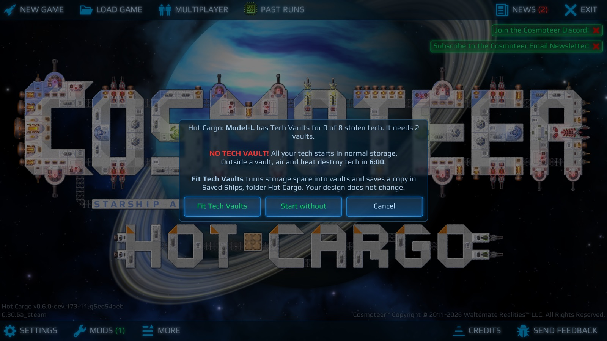

Spec: [One-tile Tech Vault](spec/39-one-tile-tech-vault.md)

<b>Difficulty, Ironman and Strike music</b>: the vanilla settings scale the chase

The vanilla difficulty settings also set how fast heat rises, how many hunters come and how much tech pays. In an Ironman career, losing the tech deletes the save. When the last heat stage starts, the battle music kicks in and stays until you get away.

Spec: [Run modes](spec/34-run-modes.md)

### Co-op

<b>Decide together</b>: see what your crewmates hover, and vote on choices

In co-op, event and story pages decide for everyone. Each player sees which option the others point at, framed in their color. Switch the page to vote mode and the most votes win, with a timer so nobody stalls.

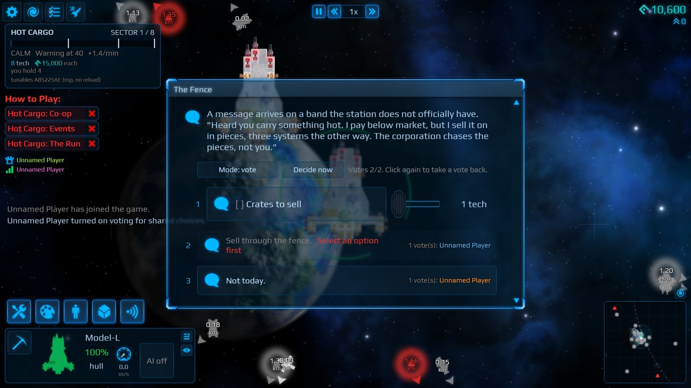

Spec: [Shared choices in co-op](spec/32-shared-choices-in-co-op.md)

<b>Listen in</b>: hear your friend bargain with a hunter, and vote on the answer

When one player hails a ship, the others get a "Listen in" button. They see the same page live and can vote on it, so a bluff or a bribe is a crew decision.

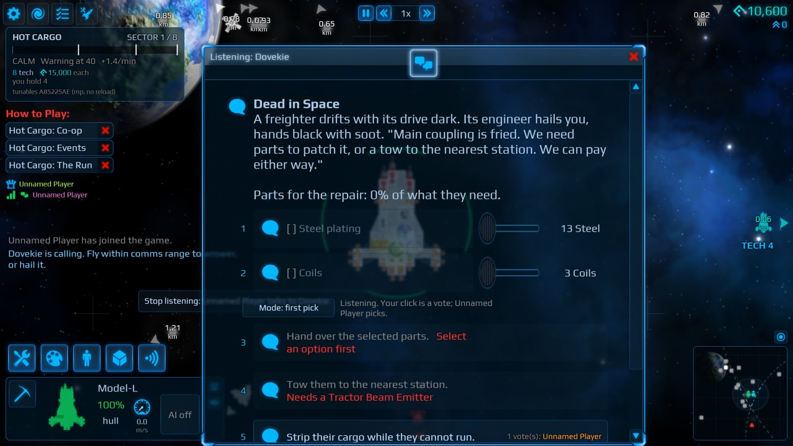

Spec: [Co-op listen-in](spec/47-co-op-listen-in.md)

<b>Share resources</b>: one switch pools the whole crew's steel and parts

In co-op, a "Share resources" switch sits next to the ship tool buttons. Any player can flip it. While it is on, everyone's ships share construction resources and help each other build, like one player's fleet. A chat line says who turned it on or off.

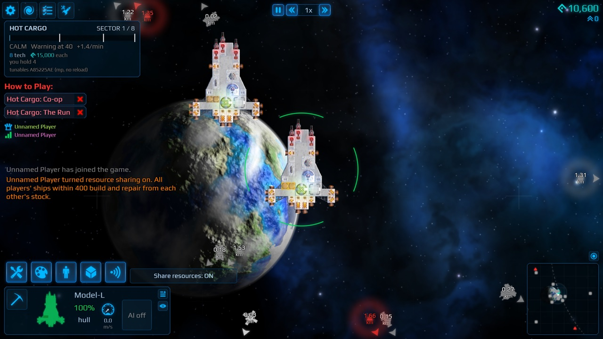

Spec: [AI upkeep, requirements 1318 to 1320](spec/53-ai-upkeep.md)

<b>Ping</b>: Alt + click to mark a spot for everyone

Alt + left click in space or on the minimap places a marker in your color that every player sees, also at the screen edge. It fades after 30 seconds.

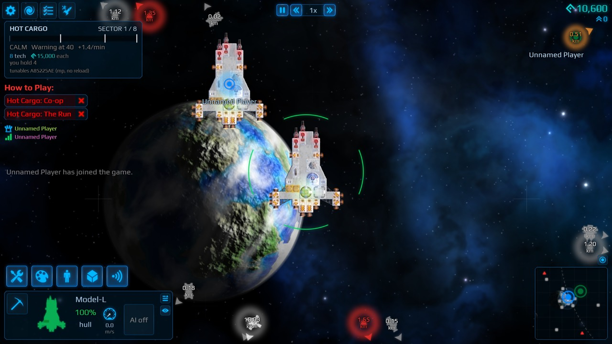

Spec: [Co-op ping](spec/57-co-op-ping.md)

<b>Enemies scale with the crew</b>: more players, more hunters

Vanilla never scales enemies with the player count. Hot Cargo does: a slider on the new career screen sets how many enemy ships each extra player adds, for hunters, pirates, missions and ambushes alike.

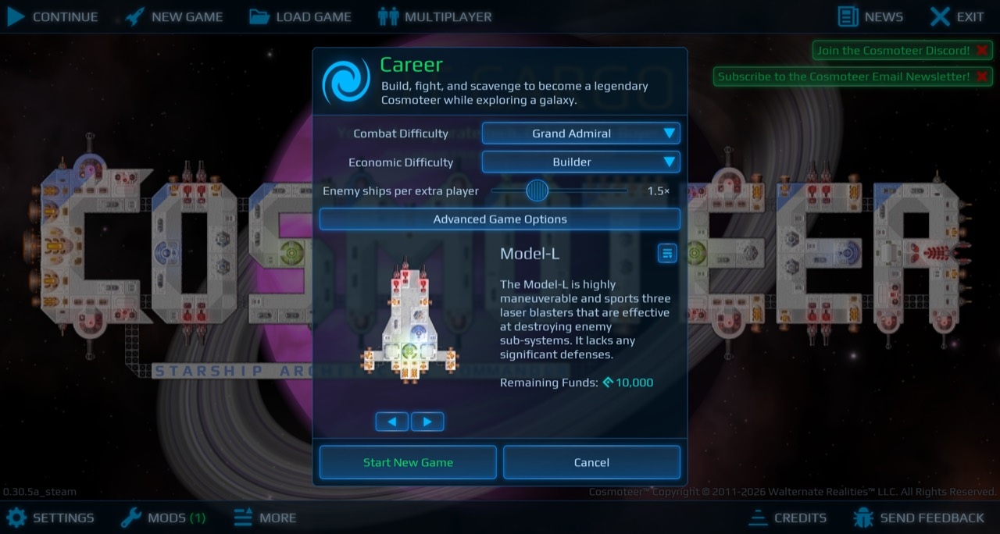

Spec: [Co-op enemy scaling](spec/28-co-op-enemy-scaling.md)

### Hunters and the Pursuit

<b>Enemies with a personality</b>: they kite, flank, bait and go for your guns

Every hostile ship fights with a personality that fits its faction and its build. Some keep out of your range, some split up and hit you from two sides, some send a fast ship to lure you away, and some aim at your weapons and engines. Damaged ships pull back to repair. You read it all from how they move.

Spec: [Hunter AI tactics](spec/12-hunter-ai-tactics.md), [AI personalities](spec/31-ai-personalities.md)

<b>Calls for help and runaways</b>: kill the caller before the ring closes

An enemy can call for help: a ring and a "CALLING HELP" label count down, and when it ends, more ships come. A ship with a sensor array hears the call early and makes it slower. Badly hurt enemies flee, and a fleeing hunter jumps out of the system unless you finish it.

Spec: [Strike waves and enemy AI](spec/23-strike-waves-and-enemy-ai.md), [AI upkeep](spec/53-ai-upkeep.md)

<b>The Pursuit</b>: scouts report you, hunters blockade the relay, and a hacker sells you silence

A director paces the chase. Hunters start weaker and grow toward the Buyer, and a stronger fleet draws a stronger response. A scout can race to a relay to report your position. A hunter pack can park at the relay you need. A network outage can stop all heat for a while, and a hacker offers to cause one for a price.

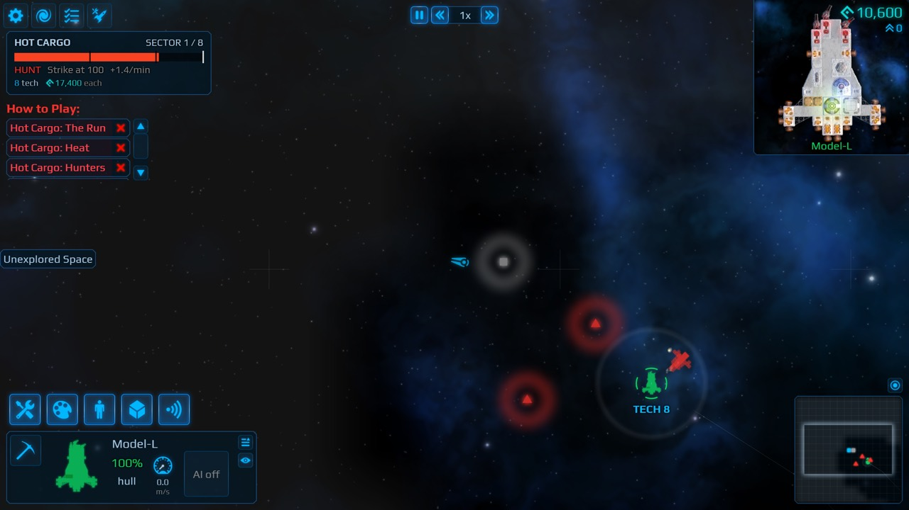
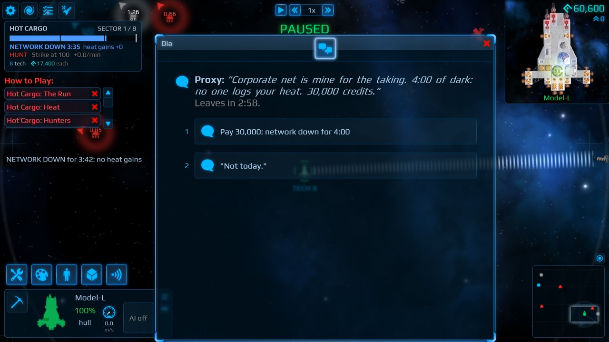

Spec: [The Pursuit](spec/51-pursuit.md)

<b>Wanted</b>: the police join in, with a way out

When a faction wants you and the heat is up, a warning names the faction and your ways out: pay the bounty, leave, or wait until the search ends. A wanted event can offer another deal.

Spec: [Events, Wanted and hunted](spec/22-events.md)

### Factions and diplomacy

<b>Talk your way out</b>: pay off a hunter, bluff, or tell them to come and take it

A hunter may hail you before it fights. Pay it off in tech or money, or hand over a few units and claim that is all you have. A bluff works better when your tech is spread over many vaults. You can also demand an enemy's surrender, or offer your own to a ship that is not a hunter. Enemies weigh the odds before they demand, flee or give up.

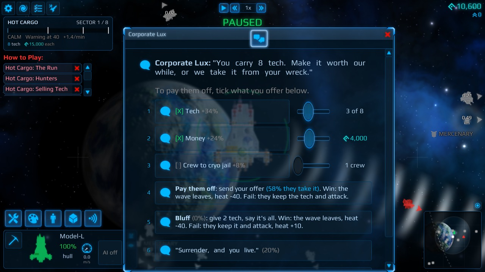

Spec: [Diplomacy](spec/37-diplomacy.md)

<b>Hide your tech with friends</b>: a friendly freighter holds it, unless it betrays you

Ask a friendly ship to hold some of your tech, so the hunters chase an empty ship. Hire an armed ship to fight for you, or take a mercenary's contract by the minute. Trust has a price: the more heat and hunters around, the likelier a friend betrays you and keeps the tech.

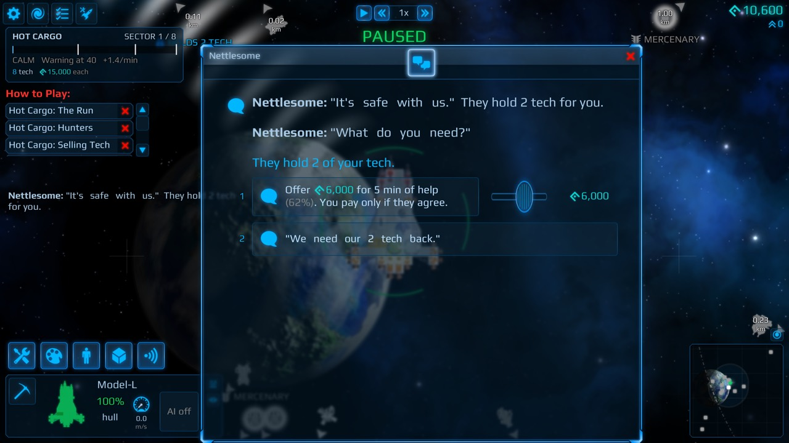
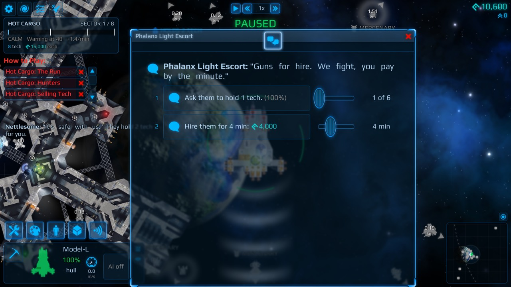

Spec: [Diplomacy](spec/37-diplomacy.md)

<b>Factions take sides</b>: hot zones pay more, friends give shelter, rivals buy tech

One faction works with the corporation. Its space is a hot zone: heat rises faster, nobody there helps you, but missions pay more. A faction that likes you gives shelter, and heat rises slower in its space. Rival stations pay more for tech. After a strike, the corporation watches the systems around you. The galaxy map tags each system, so the route is a real choice.

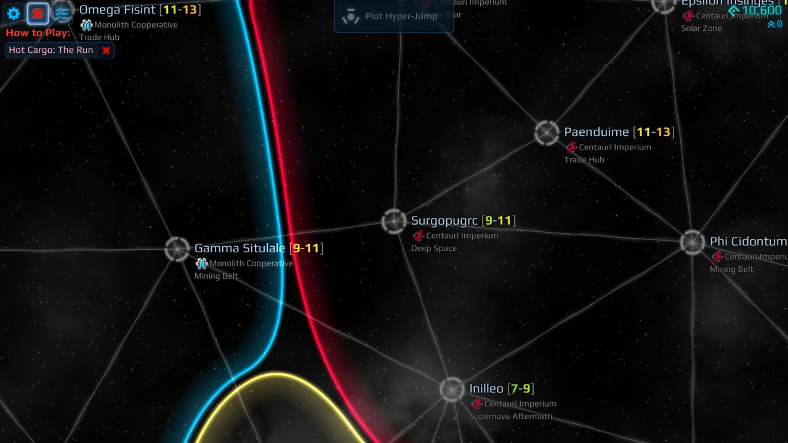
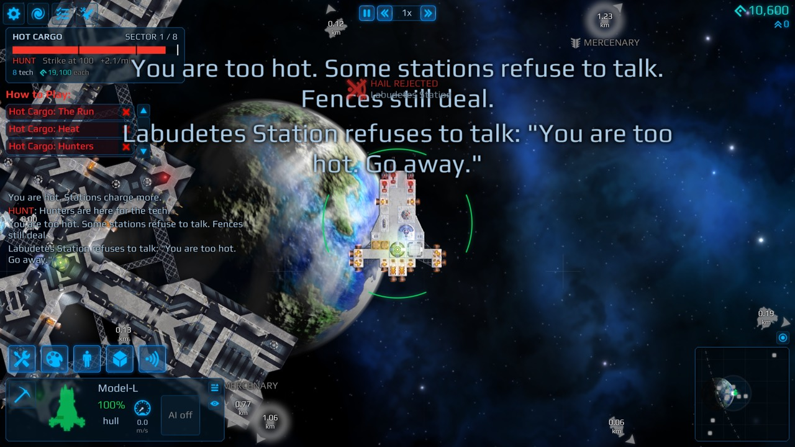

Spec: [Factions, jumps and station prices](spec/38-factions-jumps-and-station-prices.md)

<b>Relay lockdowns</b>: a closed relay, a toll, or pirates at the gate

Now and then a system next to you locks its relays. The galaxy map shows it before you jump: closed, a toll, or pirates who want a bribe. Pay or fight your way out; a closed relay opens after a while.

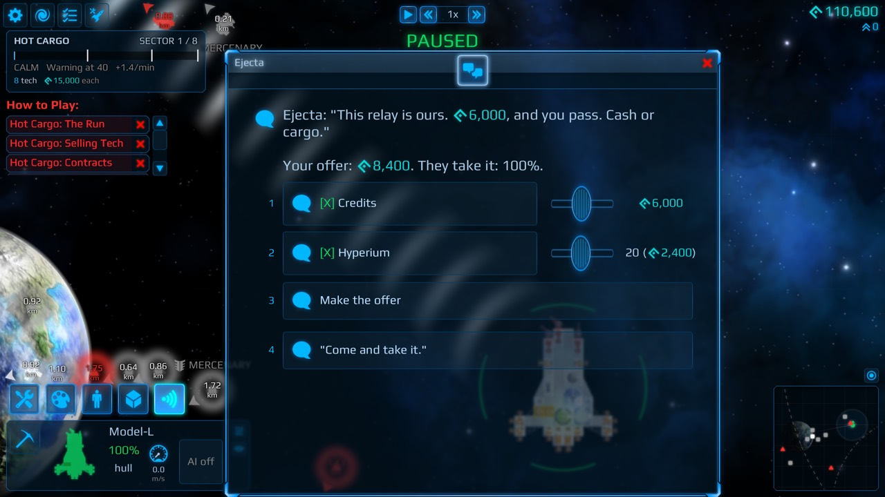

Spec: [Relay lockdowns and the timed stash](spec/43-relays-and-stash.md)

### Ship AI and autonomous ships

<b>Program your ships</b>: "if this, then that" rows for each ship, like Dragon Age tactics

Give each ship up to 16 rows of conditions and actions: "health below 30 % → retreat to an ally", "enemy attacks a vault ship → target it". Pick a preset (Aggressive, Defensive, Sniper, Escort, Vault Guard, Formation) and change it, copy and paste rows between ships, and watch the live row light up in a fight. The rows save with the ship design.

Spec: [Player ship tactics](spec/30-player-ship-tactics.md)

<b>Autonomous ships</b>: build a drone miner, looter or supply runner that works on its own

A ship with a Computer part and no control room runs only on its rows. Build a miner that sells its ore, a looter that sweeps up crates with a Funnel, a salvager, a supply runner or an escort. You cannot give it orders, so set it up well. New parts: Computer, Funnel and Targeted Reactor.

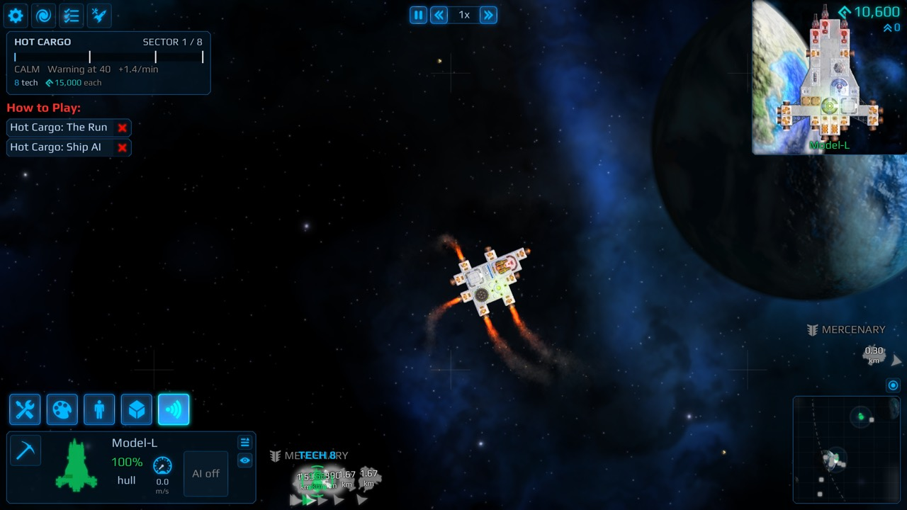
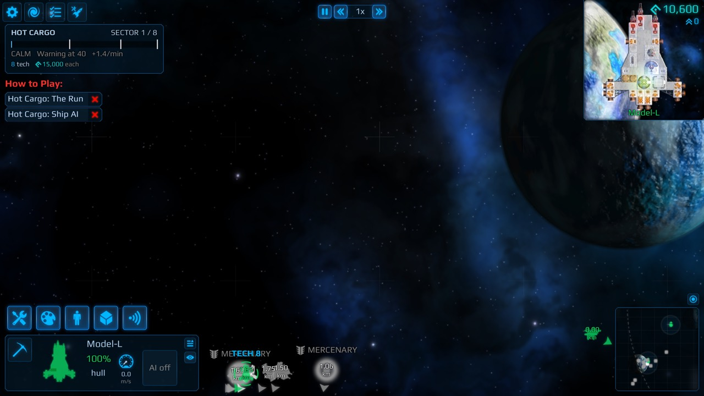

Spec: [Autonomous ships](spec/45-autonomous-ships.md)

<b>Enemies keep fighting</b>: damaged ships patch up from their allies

Enemy ships of one faction share their repair stock. A damaged ship flies to a friendly ship or station, or salvages a wreck, and repairs, so a long fight stays a fight.

Spec: [AI upkeep](spec/53-ai-upkeep.md)

### Events and the world

<b>FTL-style events</b>: distress beacons, checkpoints, fences and rival thieves

Choice events pop up on arrival, at stations and from ships you meet. Each choice shows its cost; the outcome can bring money, tech, crew, heat or an ambush. Some events come to you as a ship that hails you, with the page in its comms. The first system almost always has one.

Spec: [Events](spec/22-events.md), [Research, abandoned ships and ship comms](spec/40-events-research-abandoned-ships-and-ship.md)

<b>Story chains</b>: each station has a story in parts, and choices come back later

A station can offer the first part of a story. What you do decides the next part, and some parts find you systems later. No chain repeats until you have seen the others.

Spec: [Chains](spec/25-chains.md)

<b>Friendly encounters</b>: recruits, apprentices, traders, riddles and the Wayfarers

Not every ship wants a fight. A small ship asks to join you. An apprentice follows you to learn, and joins your fleet if it sees enough fights. A wandering trader swaps resources. A painted ship asks a riddle. And when you are badly outnumbered, the Wayfarers may jump in to help, and then ask you to pay it forward.

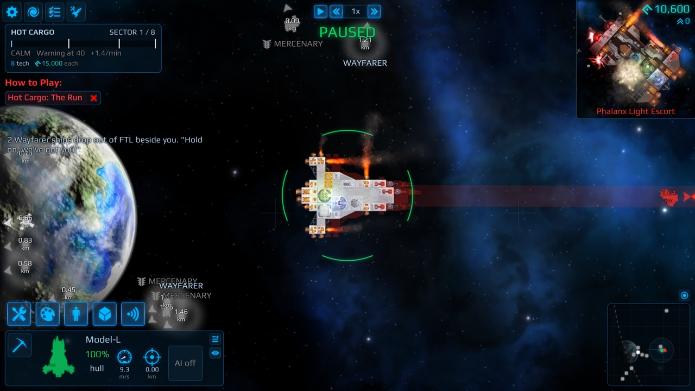

Spec: [Friendly encounters](spec/54-friendly-encounters.md)

<b>Gambles in the world</b>: open the sealed case, listen to a patrol, loot a hulk

Risky actions happen on your ship, not in a menu. Open a courier's sealed case from the storage part: it may hold access codes or a tracer that adds heat until you space it. Point a sensor array at a patrol to overhear something useful. Old hulks hold loot, and one dead ship each run still carries a unit of tech.

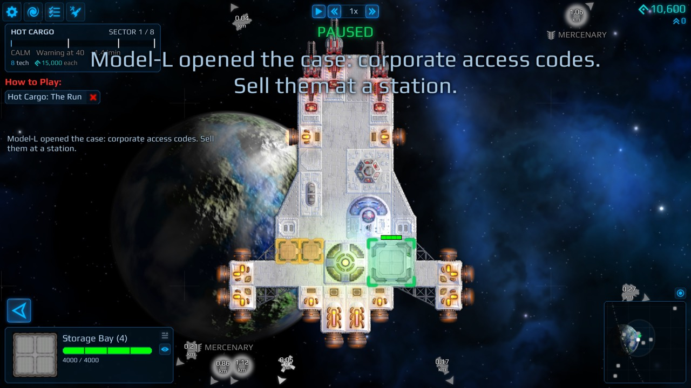
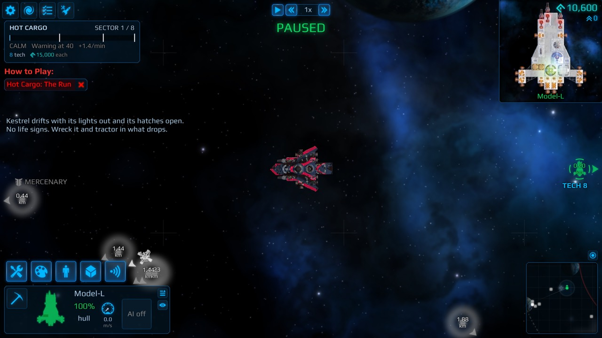

Spec: [World actions](spec/46-world-actions.md), [Mission items and hand-overs](spec/52-mission-items-and-hand-overs.md)

<b>Sector types</b>: trade hubs with currents, mining belts, solar zones and ion storms

Systems have an identity and a hazard. A trade hub has a current that pushes ships and crates. A mining belt is a dense ring of rock. A solar zone burns ships that fly too deep. Deep space hides a pirate lair in an ion storm. The arrival text and the map tooltip name the hazard.

Spec: [System archetypes](spec/27-system-archetypes.md)

<b>Scavengers</b>: they pick the system clean, but you get the first pick

Scavenger ships salvage old wrecks and loose resources and sell what they find. They never take anything fresh, and they stay friendly unless you shoot them. Factions and pirates scavenge too.

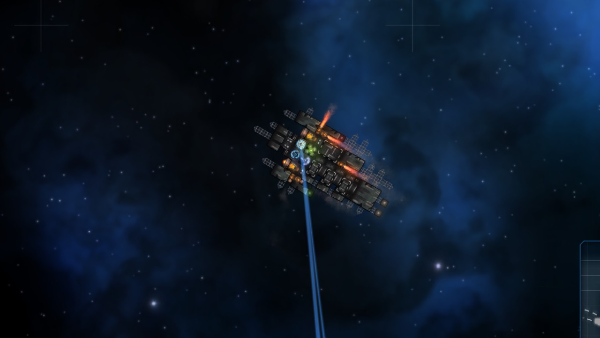

Spec: [Scavengers](spec/56-scavengers.md)

<b>The rumoured stash</b>: a timed treasure hunt in open space

Some systems have a rumour of a stash in open space. Get there before the corporation does: the longer you wait, the likelier it is empty or a trap.

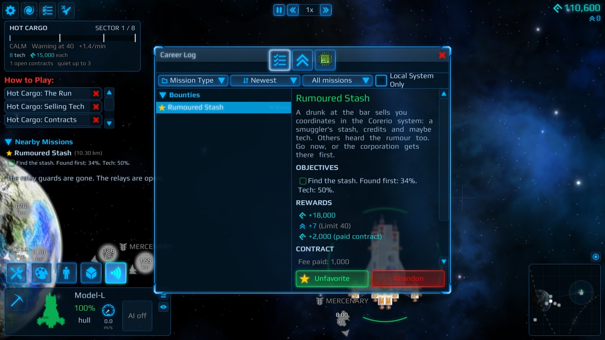

Spec: [Relay lockdowns and the timed stash](spec/43-relays-and-stash.md)

<b>Debris burns up</b>: old junk glows, then goes, so long fights stay smooth

Small loose junk with no value glows orange after a few minutes and then burns up. Wrecks worth salvage, anything with cargo or crew, and stations stay.

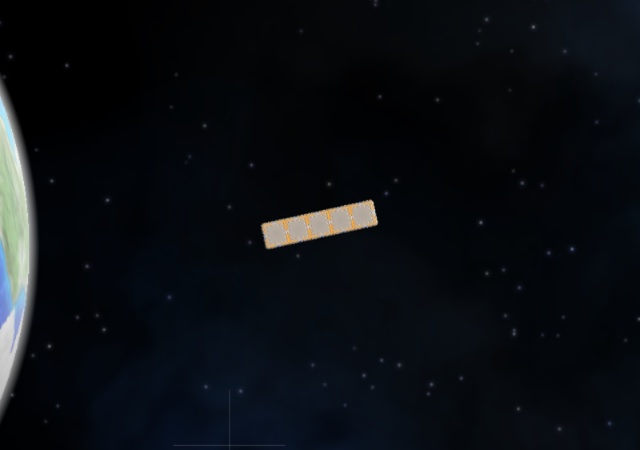

Spec: [Debris decay](spec/50-debris-decay.md)

### Missions, money and debt

<b>New missions</b>: convoys, joint strikes, sieges, sundives and bounties that may be traps

Escort a freighter, attack a base with an allied fleet, hold a listening post against drones, tow a hulk home, survey a storm, retrieve a prototype or repossess a ship. A shady bounty pays double, and the hotter you are, the likelier it is a trap.

Spec: [Missions](spec/11-missions.md), [Mechanics missions](spec/24-mechanics-missions.md)

<b>Contracts with strings</b>: fees, rivals and clients who sell you out

Some clients charge a fee up front. Some offers are rivals, and taking one closes the others. Some clients sell you out to the corporation. Every open contract leaves a trail that adds heat. The offer shows its terms before you accept.

Spec: [Contract economy](spec/26-contract-economy.md)

<b>Debt</b>: borrow now, and the collectors come later

A faction station can lend you money, and spending below zero borrows from the local faction, up to a credit limit. In co-op, each player has their own debts. The money tooltip shows what you owe and how much credit is left. Interest grows, and collectors jump in to ask for payment, with a harder tone each time. Let it run away and the lender turns hostile. The lender's debt page lets you refinance, and in a hard fight a faction can send help that you pay for afterwards.

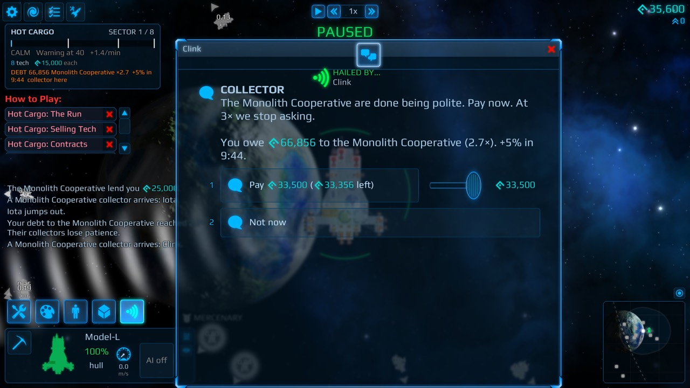
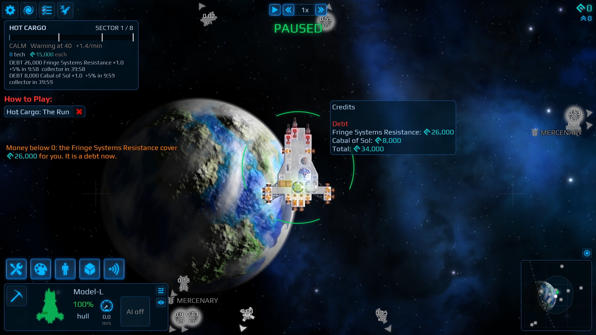

Spec: [Debt](spec/55-debt.md)

<b>Faster mission choice</b>: kind icons, a filter and a risk sort

Mission lists show each kind's icon, the jumps to other systems and the heat and risk of each offer. Filter by Hot Cargo, story, contracts or vanilla missions, and sort by risk.

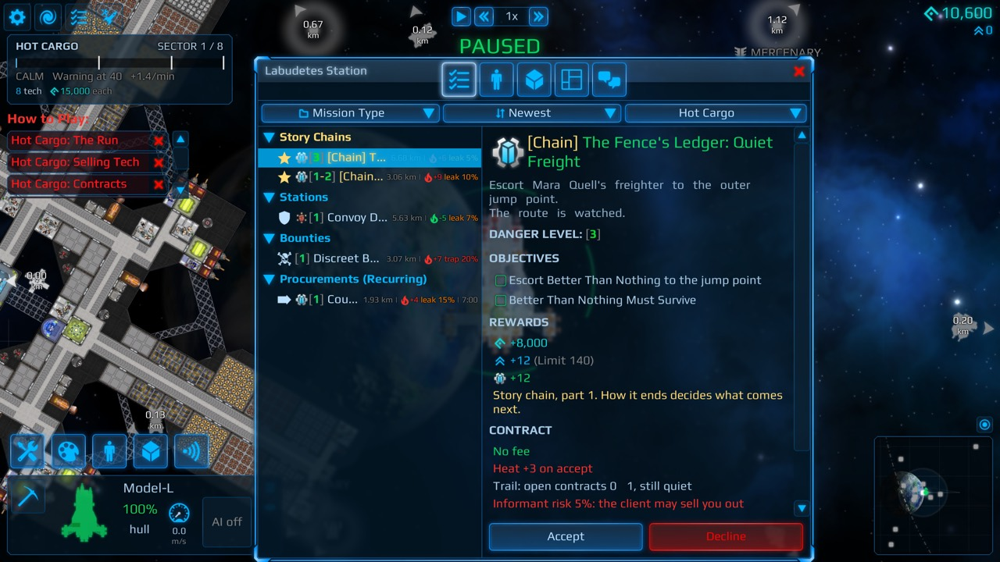

Spec: [UI: mission select, icons and event options](spec/41-ui.md)

### Quality of life

<b>Learn as you go</b>: How to Play pages and a log of your run

Hot Cargo pages join the game's How to Play list and codex and show when you first meet each mechanic. The career log gets a "Hot Cargo run" tab with the story of your run.

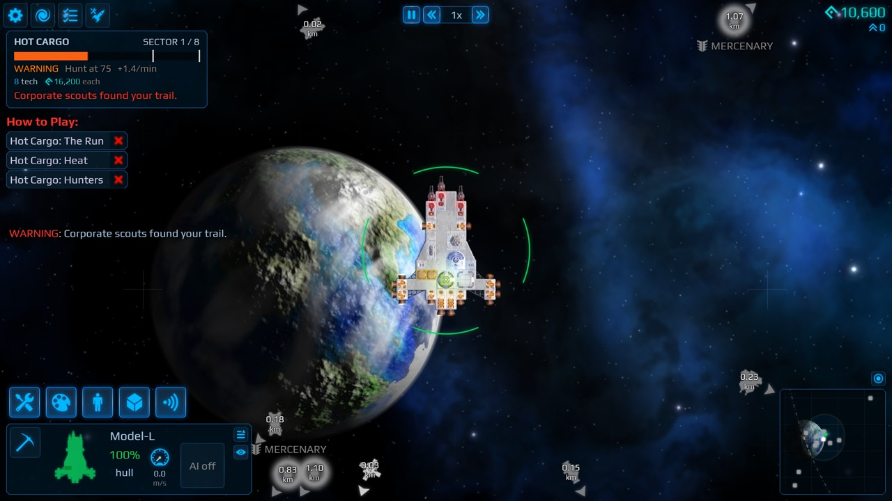
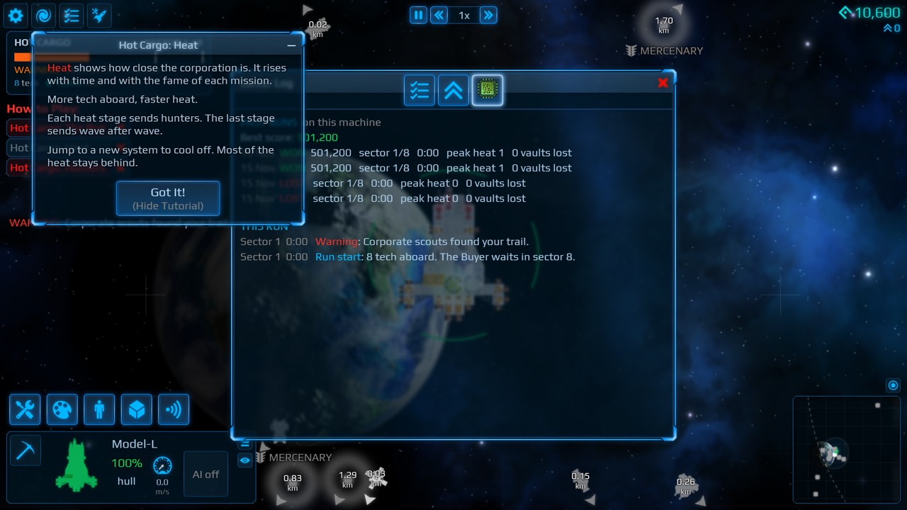
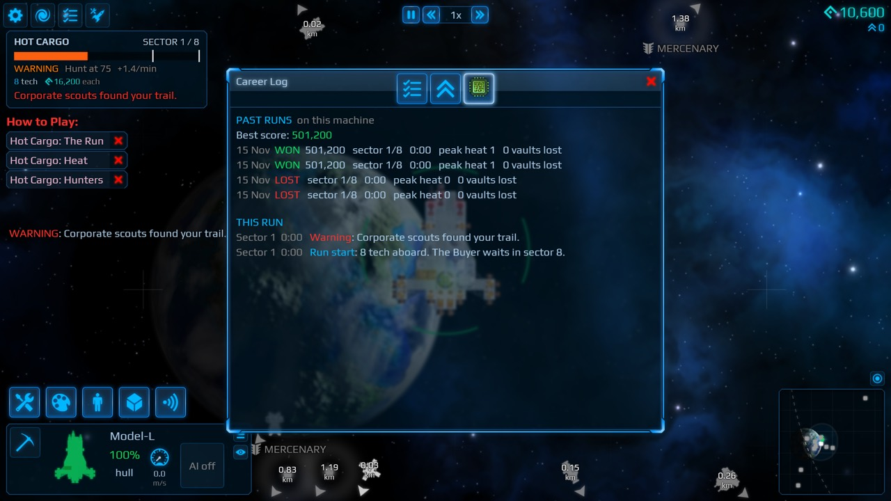

Spec: [How to Play and the run log](spec/33-how-to-play-and-the-run-log.md)

<b>Past runs</b>: every run gets a score on your record

The main menu has a Past Runs table with every run on this machine, sorted by score, with its result, length and peak heat.

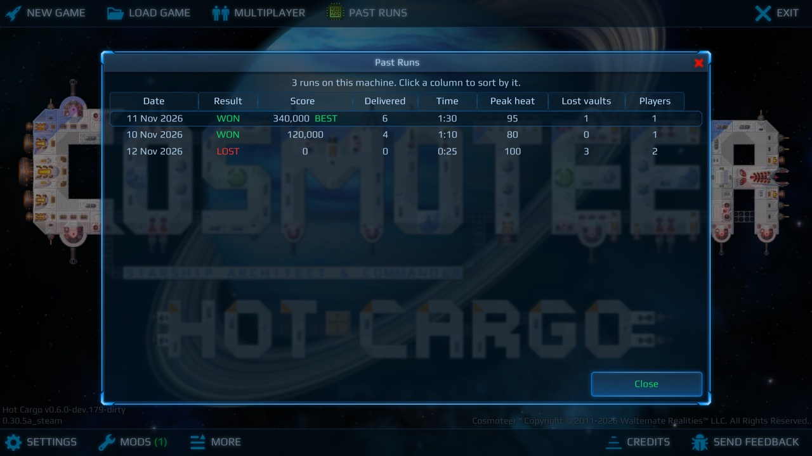

Spec: [Run record](spec/49-run-record.md)

<b>A clearer HUD</b>: hull %, loss alerts, under-fire pings and richer tooltips

Hull integrity on every ship, a banner when you lose a ship, warnings for low ammo and battery, and a ping when an off-screen ship takes fire. The galaxy map shows jumps and what waits in each system. The fame tooltip shows your crew limit, stations show their services in the comms list, and number keys pick dialogue options. A comms window pauses the game. You can switch off each change.

Spec: [UI](spec/41-ui.md), [Payment hint](spec/59-payment-hint.md), [UX.md](UX.md)

<b>Tune it live</b>: change any number while you play

A settings window in the escape menu holds every Hot Cargo number, with a description and a tag that says when a change takes effect. In co-op the host's settings apply to everyone.

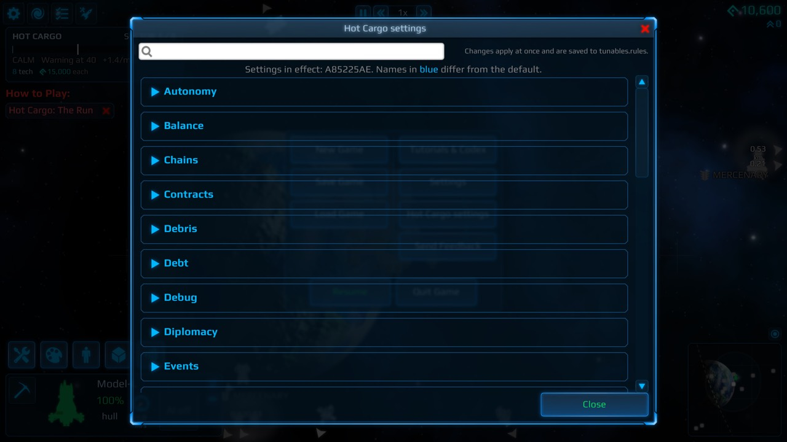

Spec: [Settings menu](spec/29-settings-menu.md)

## Install

Windows, Cosmoteer from Steam, game version 0.30.5a.

1. Download the latest zip from [Releases](https://github.com/game-design-driven/cosmoteer-hot-cargo/releases).
2. Close Cosmoteer, unzip, and double-click `install.bat`.
3. In Cosmoteer, open **Mods**, turn on **Hot Cargo**, and restart the game when it asks.
4. Start a new career. The map size "Hot Cargo run" is the default.

In co-op, every player needs the same version. Run `install.bat` again after a Cosmoteer update. `uninstall.bat` restores the game and keeps your files (tunables, telemetry, screenshots). `INSTALL.md` in the zip has the details.

Releases marked "dev" are built for every change and are not game tested. For a tested build, use the latest release without "dev".

## Tuning

Change any number in game: open the escape menu and click **Hot Cargo settings**. Changes apply at once and are saved to `Mods\hot_cargo\tunables.rules`, which you can also edit by hand while the game runs. `tunables.defaults.rules` lists every value with its default. [TUNABLES.md](TUNABLES.md) says when each change takes effect.

In co-op, the host's values apply to every player, and the new career screen has an **Enemy ships per extra player** slider.

## Develop

- [SPEC.md](SPEC.md) and [spec/](spec/): the design and the numbered requirements, one file per section.
- [CONTRIBUTING.md](CONTRIBUTING.md): the layout, the build, the tests (a headless game on macOS and Linux, test slots on a Windows PC) and releases.
- [docs/WORKFLOW.md](docs/WORKFLOW.md): how the project works, from agents and pull requests to tests and releases.
- [PLAYTEST.md](PLAYTEST.md): manual checks.
- [EVENTS.md](EVENTS.md), [MISSIONS.md](MISSIONS.md), [CHAINS.md](CHAINS.md), [WORLDS.md](WORLDS.md): the content catalogs.

## License

[MIT](LICENSE)
