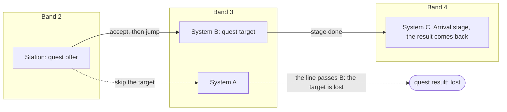
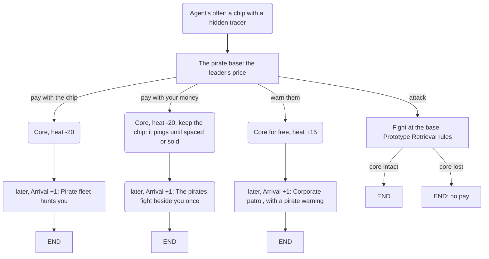
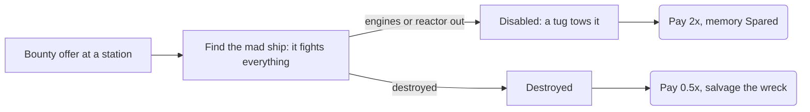
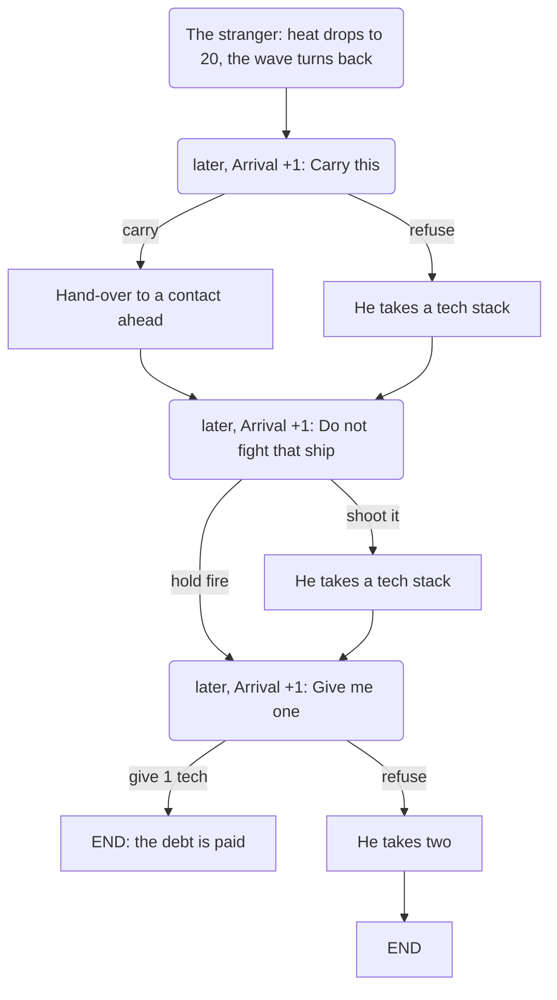
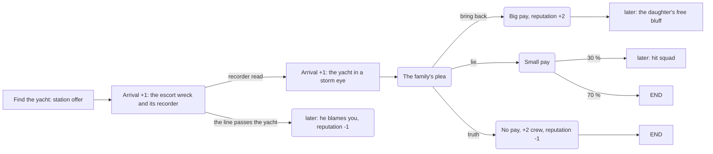
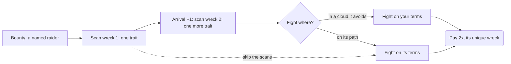
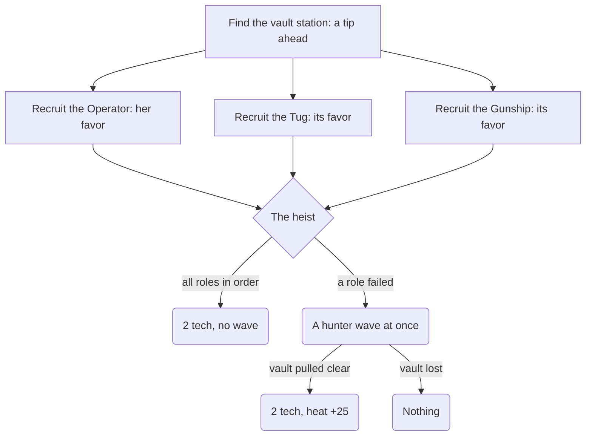
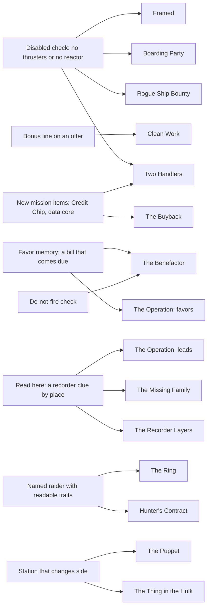

# Quests from The Witcher 3 and Cyberpunk 2077: a brainstorm

Status: brainstorm, not a spec. Nothing here is a requirement. Numbers are examples to show scale.

The goal: find quests in The Witcher 3 and Cyberpunk 2077 that people remember, and translate their flow, twist or moral choice into Hot Cargo missions and chains. Each quest gets its own name and story. We copy the shape of the quest, never its names, characters or text.

## 1. How to read this

- Section 2 says what makes these quests work, and what Hot Cargo changes about them.
- Section 3 ranks every idea in one table.
- Section 4 is the long list: every idea in a few lines.
- Section 5 is the deep dives: the best ideas, step by step, with a flow diagram.
- Section 6 lists the building blocks that several quests share. Build a block once, and several quests become cheap.
- Section 7 lists the open questions.

Terms: a **chain** is a story in stages at one station (CHAINS.md). An **Arrival stage** starts in a later system, `AfterSectors` steps later. A **callback** is a ship from a past act that comes back and hails (`spec/72-callbacks.md`). The **lockdown line** closes every system behind the players (requirement 2557).

## 2. What makes these quests work

### 2.1 The Witcher 3

- **No clean answer.** The best quests end with a choice where every option hurts someone. The player picks the lesser harm.
- **The client is not what they seem.** A sympathetic client turns out to be the cause of the problem, or a monster turns out to be a victim.
- **Delayed results.** A choice in one act pays off acts later, often when the player forgot it.
- **Contracts have a shape:** investigate the traces, learn what the target is, prepare for its weakness, then fight on your terms.
- **Deals with a stranger:** a gift now, a price that you do not know yet.

### 2.2 Cyberpunk 2077

- **Many ways in.** One job, four approaches: pay, talk, sneak, or shoot. Each approach changes who is your friend after.
- **The fixer's bonus.** Each gig has an optional goal (no kills, no alarm) that pays more.
- **The setup.** The job goes wrong on purpose. Someone set you up, and you must decide who to blame.
- **Hidden choices.** You do not always know that you made a choice until it comes back.
- **People leave you.** A partner who asked you to wait, and you did not, leaves.

### 2.3 What Hot Cargo changes

| Hot Cargo rule | What it means for a quest |
|---|---|
| The run moves forward only (requirement 2557) | No "come back to the station later". A later stage is an Arrival stage in a system ahead. |
| Pay left behind is lost (requirement 2567) | Every stage pays before you jump, or pays in the next system. |
| A run is about 6 steps (`spec/05-run-structure-and-length.md`) | A quest spans at most 3 steps. Most fit in 1 or 2. |
| Callbacks are rare: 4 per run, each kind once (requirement 2505) | A quest that ends in "they come back" competes for those 4 slots. Use a chain Arrival stage when the return must happen. |
| Gambles happen in the world (requirement 2206) | A page offers only clear deals. The risk sits in a fight, a hold action, a ship that reacts. |
| Heat is the clock (`spec/09-heat.md`) | A quest costs heat. A loud approach costs more than a quiet one. |
| Every effect is visible (requirement 2211) | A hidden choice is fine only when its result shows clearly when it lands. |

### 2.4 How a quest crosses the map

The lockdown line gives every multi-step quest a natural deadline. A quest target in a system ahead is a reason to pick that route. A quest target that the line passes is lost.

## 3. Ranking

Scores are 1 (low) to 3 (high). **Memorable**: the story, the twist or the choice. **Reuse**: how much of it exists (3 = almost all). **Pillars**: fit with `spec/02-design-pillars.md`. **Co-op**: does it give two players different jobs.

| Rank | Quest | Source | Memorable | Reuse | Pillars | Co-op | Why this rank |
|---|---|---|---|---|---|---|---|
| 1 | The Buyback | Cyberpunk, "The Pickup" | 3 | 3 | 3 | 2 | four real approaches, and every one comes back later |
| 2 | Clean Work | Cyberpunk, gig bonus goals | 2 | 3 | 3 | 2 | one rule adds a "quiet" bonus to many missions that exist |
| 3 | Rogue Ship Bounty | Cyberpunk, cyberpsycho sightings | 2 | 3 | 3 | 2 | the cheapest; it repeats and teaches careful targeting |
| 4 | The Benefactor | Witcher 3, the stranger's deal | 3 | 2 | 3 | 2 | relief now, tension all run; the same block as favors in The Operation |
| 5 | The Missing Family | Witcher 3, "Family Matters" | 3 | 2 | 3 | 1 | the strongest story; no clean ending |
| 6 | Hunter's Contract | Witcher 3, monster contracts | 2 | 2 | 3 | 3 | you learn the enemy, the mirror of enemies that learn |
| 7 | Two Handlers | Cyberpunk, Phantom Liberty's split loyalty | 3 | 2 | 3 | 2 | a betrayal that a callback can bring back |
| 8 | The Vault Job | Witcher 3, the heist in Hearts of Stone | 3 | 1 | 2 | 3 | the best co-op quest, and the most work |
| 9 | Framed | Cyberpunk, "The Heist" | 3 | 2 | 2 | 2 | a setup at a delivery; strong, but heat spikes need care |
| 10 | The Thing in the Hulk | Witcher 3, "The Whispering Hillock" | 3 | 2 | 2 | 1 | a choice whose result lands steps later |
| 11 | The Ring | Cyberpunk "Beat on the Brat", Witcher 3 fist fights | 2 | 3 | 3 | 2 | a duel circuit that reuses the scientist's duel |
| 12 | Runaway Drones | Cyberpunk, "Epistrophy" (the cabs) | 2 | 2 | 3 | 2 | 5 small hunts, each ship with a personality |
| 13 | Wrong Suspect | Witcher 3, "Carnal Sins" | 3 | 1 | 2 | 1 | an investigation where you can accuse the wrong ship |
| 14 | The Recorder Layers | Cyberpunk, braindance in "The Hunt" | 2 | 2 | 3 | 2 | a recorder that you read at 3 places to find a target |
| 15 | Supply Drops | Cyberpunk, Phantom Liberty airdrops | 1 | 2 | 3 | 3 | a world event, not a story |
| 16 | Too Good a Fence | Cyberpunk, "Sweet Dreams" | 2 | 2 | 2 | 1 | a sale that is a trap; risk of a cheap scare |
| 17 | The Puppet | Cyberpunk, "Dream On" | 2 | 1 | 2 | 1 | a client that someone else controls |
| 18 | The Double Cross | Witcher 3, "Count Reuven's Treasure" | 2 | 2 | 2 | 2 | a partner who turns at the payout |
| 19 | The Borrowed Gunship | Cyberpunk, Panam's crew and the tank | 2 | 2 | 2 | 2 | a big ship lent for one fight, and a partner who leaves if you do not wait |

The 10 earlier ideas from the coordinator thread (The Mole, Hot Potato, Boarding Party and others) are in section 4.3, with their nearest source quest.

## 4. The long list

Each entry: the source, what makes it memorable, the Hot Cargo version, what it reuses, and what is new.

### 4.1 From The Witcher 3

**The Missing Family** (source: "Family Matters", the Bloody Baron)
- Memorable: a likable, broken client; a search that slowly shows that the family fled from him; no clean ending.
- Hot Cargo: a station master pays you to find a missing ship. A flight-recorder trail across 2 steps shows that the family fled on purpose. Bring them back, let them go and lie, or tell the truth.
- Reuses: flight recorder (requirement 1144), chain stages, hand-over, Arrival stages. New: a hulk that "talks" (a recorder page). Deep dive 5.5.

**The Benefactor** (source: the stranger's deal in Hearts of Stone)
- Memorable: he gives you what you need now, and the price comes later, in a form you did not expect.
- Hot Cargo: a stranger clears your heat now. Later, at unknown times, he asks three things. Deep dive 5.4.

**The Vault Job** (source: the vault heist in Hearts of Stone)
- Memorable: you recruit a crew, each specialist wants a favor first, and the heist works only when each role does its part.
- Hot Cargo: recruit 3 ships, each with a small favor; then a heist on a corporate vault station with roles. Deep dive 5.8.

**Hunter's Contract** (source: the monster contracts)
- Memorable: investigate, learn the weakness, prepare, fight on your terms.
- Hot Cargo: a bounty on a named raider. Scan its old wrecks to learn its loadout, then pick the fight. Deep dive 5.6.

**The Thing in the Hulk** (source: "The Whispering Hillock")
- Memorable: free a voice in a tree, or kill it. Both choices hurt someone, and you learn how much only later.
- Hot Cargo: a derelict AI core asks you to carry it to a relay. Carry it: relays open for you now, and 2 steps later it takes over a station. Destroy it: a nearby colony loses its protection, and that station closes to you.
- Reuses: abandoned ships (requirements 764, 765), a mission item, a chain Arrival stage. New: a station that changes side.

**Wrong Suspect** (source: "Carnal Sins")
- Memorable: a murder investigation where the obvious suspect is innocent, and you can accuse them.
- Hot Cargo: ambushes on freighters. Three ships in the system are suspects. Scan each one (sensor array, like Storm Survey) and read their logs. Accuse one: the military station attacks it. If you picked wrong, the real raider strikes again and the station blames you.
- Reuses: sensor scans, Patrol Chatter listen. New: a suspect list, a "guilty" flag on one ship.

**The Ring** (source: the fist fight circuit, "Fists of Fury")
- Memorable: a ladder of one-on-one fights, each fighter with a style, and a champion at the top.
- Hot Cargo: a pit station runs ship duels. 3 duels across the run, one per step, each one ship against one. Fight fair, or let a friend shoot, and lose the purse.
- Reuses: the scientist's duel rules (requirements 491 to 493: a champion, interference). New: a purse and a ladder. Cheap.

**The Double Cross** (source: "Count Reuven's Treasure")
- Memorable: you help a partner take back a treasure, and at the payout someone turns.
- Hot Cargo: a partner ship helps you raid a depot. At the split, it demands all of it, or it sells your route. Fight, pay, or warn the depot crew before the raid.
- Reuses: `ChainDepot`, hire (requirement 579), the betrayal roll of held tech (requirement 576). New: a partner whose side changes.

### 4.2 From Cyberpunk 2077

**The Buyback** (source: "The Pickup")
- Memorable: one job, four approaches: pay with your own money, pay with the corp's tagged chip, warn the gang, or shoot. Each approach changes who your friends are.
- Hot Cargo: a gang took a corp prototype. The corp gives you a credit chip with a hidden tracer. Deep dive 5.1.

**Clean Work** (source: the fixers' gigs and their bonus goals)
- Memorable: the job is simple; the bonus goal makes you play it in another way.
- Hot Cargo: one rule for many missions. Each offer can carry a bonus line: "no kills", "no hunter stage", "no ship lost", "under 5 minutes". Meet it for +30 % pay. Deep dive 5.2.

**Rogue Ship Bounty** (source: the cyberpsycho sightings)
- Memorable: take the target alive for a better reward.
- Hot Cargo: a ship whose crew went mad. Disable it for double pay, or destroy it for a little. Deep dive 5.3.

**Two Handlers** (source: Phantom Liberty's split between two handlers)
- Memorable: two allies want opposite things, you must betray one, and the one you betray turns on you.
- Hot Cargo: a defector and a corporate agent both want the same data core. Give it to one. Deep dive 5.7.

**Framed** (source: "The Heist")
- Memorable: the client dies in front of you, and you take the blame.
- Hot Cargo: you arrive to deliver to a corporate executive's ship. A third ship destroys it in front of you. Heat jumps, and your cargo is now evidence. Hand it to the corp (heat clears, no pay), sell it to their rivals, or track the real killer ship.
- Reuses: heat, a mission item, careful targeting, the Wanted Broadcast hunters. New: the killer ship with an escape route to a relay.
- Risk: a heat spike that you did not choose. Keep it small, and show the killer ship at once, so the cause is visible.

**Runaway Drones** (source: "Epistrophy", the runaway AI cabs)
- Memorable: one AI, many personalities, each one hidden somewhere and each one acts in its own way.
- Hot Cargo: a shipping company's autopilot drones escaped. One per step. Each drone has one behavior: one flees, one hides in an asteroid field, one rams, one begs, one hides in a current. At the end, reset them, merge them, or set them free.
- Reuses: autonomous ship AI (`spec/45-autonomous-ships.md`), tow, archetype hazards. New: 5 small drone behaviors.

**The Recorder Layers** (source: the braindance in "The Hunt")
- Memorable: you replay a recording and switch layers (sound, heat, view) to find clues no one else sees.
- Hot Cargo: a flight recorder that gives a different clue at each place you read it: in a sun's heat zone, in an ion storm, near a station's scanner. Two clues give the target system ahead; three give the target ship.
- Reuses: flight recorder, item actions (requirement 1111), archetypes. New: a "read here" action that depends on the place. Shares a block with The Operation's leads.

**Supply Drops** (source: the Phantom Liberty airdrops)
- Memorable: a drop falls, and every gang in the area races for it.
- Hot Cargo: drop pods land in the system. Scavengers and hunters race you for them.
- Reuses: scavengers (`spec/56-scavengers.md`), loose cargo, markers. New: the pod. A world event, not a story quest.

**Too Good a Fence** (source: "Sweet Dreams")
- Memorable: a deal that is too good, and you wake up with parts missing.
- Hot Cargo: a fence offers 1.6 × tech value. It is a scavenger crew. If you dock, they strip 2 parts of your ship with a cutting beam and run. You see the tells first: no faction, a cutting laser, a ship with empty bays.
- Reuses: Off the Books (requirement 1801), scavenger cutting, the ship cut. New: a hostile scavenger. Risk: a trap with no tell is a cheap scare; the tells must show.

**The Puppet** (source: "Dream On")
- Memorable: you find that someone controls your client, and you choose whether to tell him.
- Hot Cargo: a station chief who protects you sends odd orders. A listen near his couriers shows that the corporation feeds him his ideas. Tell him (his station turns hostile to the corp, and the corp turns on him), or use it (he becomes a sure informant you can feed false routes).
- Reuses: Patrol Chatter listen, chain pages. New: a station that changes side.

**The Borrowed Gunship** (source: Panam's crew and the tank)
- Memorable: a crew lends you a weapon too big for you; their leader asks you to wait, and leaves if you do not.
- Hot Cargo: a nomad crew lends you a heavy gunship for one fight against a corporate depot. Return it after, or keep it and make enemies. If you start the fight before their signal, they leave.
- Reuses: join (requirement 1361), `ChainDepot`. New: a ship that is yours for one fight.

### 4.3 The earlier ideas

These came from the coordinator thread before the Witcher and Cyberpunk list. Each one has a nearest source.

| Idea | Pitch | Nearest source | Overlap |
|---|---|---|---|
| The Mole | a new crew member leaks your route; find and deal with them | Witcher 3 "Wrong Suspect" pattern | grew into The Infiltrator Director in the Operation brainstorm |
| Hot Potato | a "cursed" crate that doubles heat gain, paid well 3 steps ahead | Cyberpunk, the Relic chip | uses the vault and heat; strong in co-op (pass it between ships) |
| Boarding Party | disable a courier, breach it, grab a data core | Cyberpunk gigs (infiltrate) | covered by The Vault Job; uses the crew breach (`spec/61-crew-breach.md`) |
| Cold Run | escort a ship with a damaged reactor through a sun's heat zone | Witcher 3 escort quests | an escort variant |
| Relay Saboteur | plant a device at a faction relay and hold it | Cyberpunk, sabotage gigs | close to Hold the Pass; the relay lockdown (requirement 950) does the result |
| The Decoy | a cheap hull with your transponder draws the hunters | Cyberpunk, the decoy in "The Heist" | the event Decoy Run (EVENTS.md 26) has the name; needs a fake identity |
| Salvage Rights Dispute | two factions claim one wreck | Witcher 3, the noble feuds | close to the mission Salvage Rights; rename it |
| Smuggler's Ledger | a ledger of names, sell or blackmail across steps | Witcher 3, "Reason of State" | uses chain flags |
| Last Stand Station | evacuate a falling outpost, limited by bunks | Cyberpunk, Phantom Liberty's evacuation | uses Station under attack |
| Ghost Signal | a derelict AI wakes and turns drones on you | Phantom Liberty, the lab hunt | Ghost Signal is already an event name (EVENTS.md 16); merge into The Thing in the Hulk |

## 5. Deep dives

### 5.1 The Buyback (rank 1)

**Source.** Cyberpunk 2077, "The Pickup". A gang holds a stolen military robot. A corporate agent gives you a credit chip to buy it, and the chip carries a virus. You pick how to get the robot: pay with the chip, pay with your own money, warn the gang about the virus, or shoot your way in. Each choice decides who is your friend after.

**Hot Cargo version.** A pirate crew took a corporate prototype core. A corporate agent hails you with an offer: buy it back for the corp, with the corp's credit chip.

**Steps.**
1. A corporate agent's ship hails. It gives you a **Credit Chip** item (a mission item, requirement 1100). The offer text says that the pay is a heat cut.
2. The pirates sit at their base in the same system. Their leader's ship hails with a price.
3. You choose how to get the core (table).
4. Hand the core to the agent's ship (hand-over, requirement 1102).
5. One step later, the result comes back (an Arrival stage).

**Choices and outcomes.**

| Approach | Now | Later (Arrival stage, 1 step on) |
|---|---|---|
| Pay with the chip | the core, heat −20 | the pirates find the tracer in the chip: a pirate fleet hunts you |
| Pay with your own money | the core, heat −20; the chip is yours, and its tracer adds heat until you space it or a fence buys it | the pirates remember a fair deal: they fight beside you once |
| Tell the pirates about the tracer | they give you the core for free; the corp agent is angry: heat +15 | the agent sends a corporate patrol, and the pirates warn you first |
| Take it by force | a fight at the base; the core can break (Prototype Retrieval rules) | nothing more: no one is left to remember |
| Open the chip in the hold first | you see the tracer (a Tracer Beacon, requirement 1116) | it changes what you know, not the options |

**Reuses.** Tracer Beacon, the Sealed Case "open it in the hold" action (requirement 1115), hand-over, Prototype Retrieval, pirate base, chain pages, Arrival stages. **New.** The Credit Chip item; a pirate fleet that helps once.

**Callbacks and the line.** The result comes back as a chain Arrival stage, so it does not use one of the 4 callback slots. The pirates' help is a memory, `SparedPirate`, which the callback Pirate's Honor (requirement 2507) can bring back later.

**Why rank 1.** Four approaches, none always best. Each one costs something now or later. Almost every part exists.

### 5.2 Clean Work (rank 2)

**Source.** Cyberpunk 2077 gigs. A fixer gives a job, and some jobs carry an optional goal: no kills, no alarm, keep the target alive. Meet it, and the pay is higher. The bonus makes you play the same job in another way.

**Hot Cargo version.** Not one quest: one rule for many missions. An offer can carry one bonus line. Meet it for +30 % money.

| Bonus | Check | Fits |
|---|---|---|
| Quiet: no hunter stage starts | no heat stage starts during the mission | Courier Job, Storm Survey, Sundive |
| Clean: no kills | no enemy ship becomes a wreck by your fire | Repossession, Prototype Retrieval |
| Fast: under N minutes | mission time | Salvage Rights, Sunside Ore |
| Whole: no ship lost | no player ship lost | Hold the Pass, Claim Jumpers |
| Kind: the escort takes no damage | escort hull health | escorts |

**Reuses.** Every mission; the contract terms (requirement 228) already add terms to offers. **New.** One bonus line, one check per bonus kind, and a "BONUS MET" or "BONUS LOST" line.

**Why rank 2.** One small rule changes how many missions play. It is the best value per work in this list. It also fits "move on or burn" (requirement 2201): Quiet rewards a fast, calm job.

**Risk.** A bonus on every mission becomes noise. Put a bonus on about 1 offer in 3.

### 5.3 Rogue Ship Bounty (rank 3)

**Source.** Cyberpunk 2077, the cyberpsycho sightings. A person whose implants broke them attacks everyone. The client asks you to take them alive, which is much harder.

**Hot Cargo version.** A station posts a bounty on a ship whose crew went mad. It attacks everything near it: you, traders, pirates.

**Steps.**
1. Accept at a station. The target shows on the map.
2. Find it. It fights anything near it, so it may already be in a fight.
3. Disable it: destroy its engines, or its reactor, or kill its crew below a share. The crew lives.
4. A station tug comes and tows it (the Rescue Tow of the Rescue Beacon, EVENTS.md 35).

**Outcomes.** Disabled: 2× standard money. Destroyed: 0.5×. You can still salvage the wreck after a kill.

**Reuses.** The surrender check (requirement 567, lost health), Prototype Retrieval's careful targeting, the rescue tug. **New.** The "disabled" check: no working thrusters, or no working reactor. That check is a building block (section 6): Boarding Party, Framed and Two Handlers use it too.

**Callbacks and the line.** A disabled crew can come back healed and grateful: a new memory kind `Cured`, or it uses `Spared`.

### 5.4 The Benefactor (rank 4)

**Source.** The Witcher 3: Hearts of Stone. A polite stranger helps the hero when nothing else can, and later asks for three impossible things. The price was always the point.

**Hot Cargo version.** A plain courier ship with no faction hails you at the worst moment: heat at 90, a Strike wave on the way. "I can make this go away." Accept: heat drops to 20, and the wave turns back. He asks nothing now.

**The three asks.** Over the next steps, at a time you cannot predict, his courier hails again. Each ask is a clear deal (requirement 2206):

1. **Carry this.** A sealed case to a contact ahead. You may not open it. (Courier Job hand-over.)
2. **Do not fight that ship.** A named hunter is in the system. Let it go: no shot at it for 3 minutes. (A new "do not fire" check.)
3. **Give me one.** One tech unit. (`Need { Tech = 1 }`.)

**Refuse an ask:** he takes his price his way. A tech stack goes missing from one vault, with a chat line from him.

**Reuses.** The courier hand-over, callbacks (a new memory kind, `Favor`), tech costs. **New.** The `Favor` memory and the "do not fire" check. The same block is the favors of The Operation brainstorm ([#398](https://github.com/game-design-driven/cosmoteer-hot-cargo/pull/398) "docs: brainstorm The Operation, a corporate Director per run"), so it serves both.

**The line.** The asks come as Arrival stages, 1 step apart. A run that ends first never pays the last ask. That is the gamble.

**Pillar check.** Rare (requirement 2210): at most once per run, only above heat 80.

### 5.5 The Missing Family (rank 5)

**Source.** The Witcher 3, "Family Matters". A rough lord asks you to find his wife and daughter. On the way you learn that they fled from him, and why. The quest ends with a choice where every option hurts someone.

**Hot Cargo version.** A station master pays you to find a missing yacht with his family aboard.

**Steps.**
1. Station offer. Pay is high.
2. In the next system, a wreck of the yacht's escort. Its flight recorder (Sundive rules) shows that the yacht turned off its transponder by choice.
3. In the system after, the yacht sits in a Deep Space storm eye or hides in a belt. The family hails: they fled from him.
4. You choose.

**Choices and outcomes.**

| Choice | Now | Later |
|---|---|---|
| Bring them back | big pay, his station's faction +2 reputation | an Arrival stage: the daughter, now crew on a hunter, bluffs you once (a bluff that cannot fail) |
| Let them go and lie | small pay | 30 %: his hunters find out, and a hit squad comes (Arrival) |
| Tell him the truth | no pay | his faction −1 reputation, and the family joins you as crew (+2 crew) |

**Reuses.** Flight recorder, Arrival stages, hand-over, a chain at one station (CHAINS.md). **New.** A yacht that hides in an archetype hazard.

**The line.** Steps 2 and 3 are in systems ahead. If the line passes step 3's system first, the yacht is lost, and the station master blames you (Arrival stage, reputation −1).

**Overlap.** The flight-recorder trail is close to The Black Box (CHAINS.md 3.6). Keep the two apart: The Black Box is about corporate data, this one is about people.

### 5.6 Hunter's Contract (rank 6)

**Source.** The Witcher 3, the monster contracts. You read the tracks, learn what the beast is, prepare the right oil and bomb, then fight it where you choose.

**Hot Cargo version.** A bounty on one named raider ship, one tier above the system. It moves through the systems ahead.

**Steps.**
1. Accept at a station. The raider is named, its loadout is "unknown".
2. Its old wrecks lie in this system and the next. Scan each with a sensor array (Storm Survey rules). Each scan reveals one line: "lasers burned through 2 m of armor" (it uses lasers), "missile holes on the left side" (it attacks from its left), "it never fought in a cloud" (it avoids nebulae).
3. You pick when and where to fight it. Refit if you want; it is never required (requirement 2208).
4. It fights with its real loadout. A prepared player wins faster.

**The mirror.** Enemies learn how you fight (`spec/67-enemies-learn.md`). This quest is the same rule pointed the other way: you learn how it fights.

**Reuses.** Wrecks, sensor scans, careful targeting, enemies that learn (its "habits" data shape). **New.** A named raider design with 3 readable traits.

**Co-op.** One player scans while the other guards. It gives a scout role.

### 5.7 Two Handlers (rank 7)

**Source.** Cyberpunk 2077: Phantom Liberty. You work for two handlers who need each other, until each asks you to betray the other. The one you betray becomes your enemy, and the story splits.

**Hot Cargo version.** A corporate defector and a corporate internal-affairs agent both want one data core.

**Steps.**
1. The defector hires you: grab the data core from a corporate courier (careful targeting: disable, do not destroy).
2. On the way back, the agent hails: "Bring it to me instead. I clear your record."
3. You choose. Each choice is a clear deal on its page.

**Choices and outcomes.**

| Give the core to | Now | Later |
|---|---|---|
| The defector | money, she joins as crew (+1) | a memory `Betrayed` (the agent): a corporate patrol that knows your route |
| The agent | heat −40, no money | the defector's friends come for you (like Okafor's Friends, CHAINS.md 3.2) |
| Neither: sell it to a fence | money × 1.5 | both come, one step apart |

**Reuses.** The courier hit, hand-over, the Quiet Defector chain's shape, callbacks. **New.** A memory `Betrayed`, so the callback says "You chose her at <system>."

### 5.8 The Vault Job (rank 8)

**Source.** The Witcher 3: Hearts of Stone, the vault heist. You need a crew. Each specialist asks a favor before they join. During the heist each role must work, or the job fails.

**Hot Cargo version.** A corporate vault station in a system ahead holds 2 tech units. Recruit 3 ships in the systems before it.

**The crew.**

| Role | What it does in the heist | Its favor first | Reuses |
|---|---|---|---|
| The Operator | shuts the station's relay calls for 60 s, so no wave comes | bring her a sensor array part | relays, the outage (requirement 920) |
| The Tug | pulls the vault container clear | escort it past raiders | tow, escorts |
| The Gunship | draws the station's guards away | pay its debt (The Debtor, requirement 1367) | hire |

**The heist.** The roles must happen in order: the Operator cuts the calls, the Gunship pulls the guards, the Tug pulls the vault. A role that fails starts a hunter wave at once. Missing a role: the job is still possible, but loud.

**Co-op.** Each player can lead one role. The best co-op quest in the list.

**Cost.** High. It needs a new station layout and three helper behaviors. Build it after Rogue Ship Bounty's "disabled" check and the escort blocks exist.

## 6. Building blocks

Several quests need the same new piece. Build a block once, and every quest that uses it gets cheaper. This is the systematic order.

| Block | Size | Quests that use it |
|---|---|---|
| Disabled check | small; next to the surrender check | Rogue Ship Bounty, Two Handlers, Boarding Party, Framed |
| Bonus line | small; next to the contract terms | Clean Work, and any mission |
| `Favor` memory kind | small; requirement 2500 allows new kinds | The Benefactor, The Operation |
| Do-not-fire check | small | The Benefactor, The Ring |
| Read here | medium | The Recorder Layers, The Missing Family, The Operation leads |
| Named raider traits | medium | Hunter's Contract, The Ring |
| Station that changes side | medium | The Thing in the Hulk, The Puppet |
| New mission items | small each (requirement 1100) | The Buyback, Two Handlers |

## 7. Suggested order

1. **Clean Work** and **Rogue Ship Bounty**: small, and they add the bonus line and the disabled check.
2. **The Buyback**: the best quest, and almost all of it exists.
3. **The Benefactor**: adds the `Favor` memory, which The Operation also needs.
4. **The Missing Family** or **Hunter's Contract**: the next story, by taste.
5. **The Vault Job**: last, when the blocks exist.

## 8. Open questions

1. **Order.** Start with Clean Work, Rogue Ship Bounty and The Buyback? Or is a story quest first more important to you?
2. **Clean Work.** A bonus on about 1 offer in 3, at +30 % money: right, or too much noise?
3. **Callbacks or Arrival stages.** Quest results come back as chain Arrival stages, so they do not use the 4 callback slots. OK?
4. **The Benefactor's price.** A refused ask takes a tech stack. Too harsh, or right for a deal that took heat from 90 to 20?
5. **Too Good a Fence.** A trap sale with visible tells: keep it, or cut it?
6. **The Vault Job.** Worth its cost as the co-op showpiece?
7. **Names.** Rename the earlier idea "Ghost Signal", which clashes with the event of the same name?
