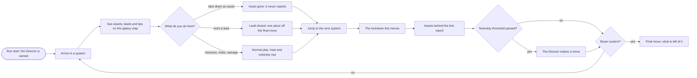
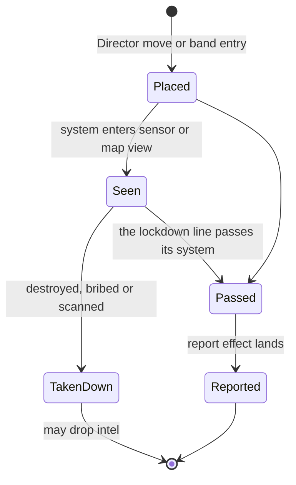
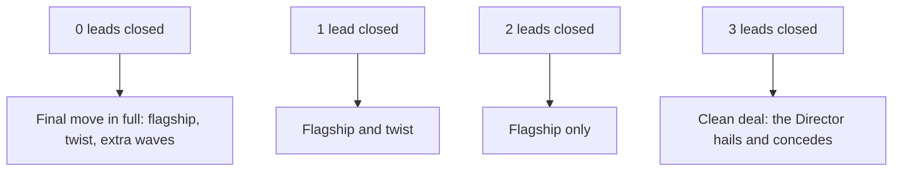
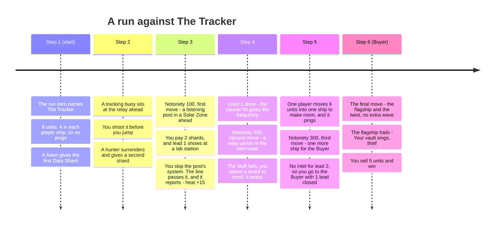
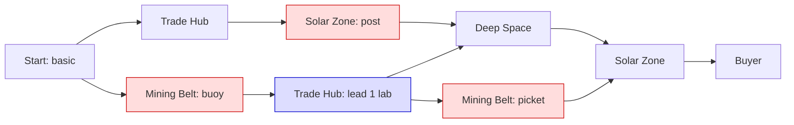

# The Operation: a brainstorm

Status: brainstorm, not a spec. Nothing here is a requirement. The numbers are examples to show scale, not tunables.

The question: how does the structure of Eldritch Horror fit Hot Cargo, with no supernatural theme? The answer in one line: **each run, one corporate Director takes your case and runs an operation against you, and you race to break it before you reach the Buyer.**

## 1. The idea in short

- At the start of a run, the corporation names a **Director**. The Director has one rule twist, three **leads** you can work against, and one **final move** at the Buyer.
- **Notoriety** is the clock. It already exists: the sum of all heat gains in the run (`spec/08-tech-value-and-selling.md`, requirement 19). Each threshold of notoriety gives the Director one **move**. No new clock.
- The Director puts **assets** in systems ahead of you: listening posts, relay pickets, informant stations. Take an asset down, or it **reports** when the lockdown line passes it.
- You collect **intel** from captured hunters, flight recorders and comms. Spend it to reroll a gamble, or keep it to work a lead.
- Each lead you close takes one piece off the final move. Close all three, and the deal at the Buyer is clean.

## 2. What makes Eldritch Horror work

Eldritch Horror is a co-op board game. Players travel the world and race an Ancient One that wakes up when the doom track reaches zero. Six engines make it tense:

1. **One villain per game sets the rules.** Each Ancient One has its own mysteries, its own special cards and its own final fight. The same board plays differently.
2. **A doom track that always moves.** Each round moves it. Open gates and some events move it more.
3. **Gates that grow when you ignore them.** Gates open on the map. An open gate spawns monsters and adds doom. Players close gates, or let them grow.
4. **The omen track cycles colors.** Each round the omen moves one step (green, blue, red, blue). When the omen matches the color of an open gate, that gate adds doom. Players see the next omen and plan for it.
5. **Clues are a currency with two uses.** A clue rerolls one die, or it pays for a step of a mystery. Each spend now is a spend that the mystery does not get.
6. **Mysteries are the way to win.** Solve three mysteries before doom reaches zero, and you win. Each mystery asks for a different kind of action.

Two smaller engines fit too:

- **Conditions:** a deal or a blessing that helps now and has a card that can turn bad later ("Debt", "Dark Pact").
- **Rumors:** a timed card on the map. Deal with it in time, or a bad result happens.

## 3. The mapping

| Eldritch Horror | Hot Cargo version | What it reuses | What is new |
|---|---|---|---|
| Ancient One | **The Director** (one per run) | the corporation, hunters, heat stages (`spec/10-corporate-response.md`) | the Director pick, its rule twist, its hails |
| Doom track | **Notoriety thresholds** give the Director moves | notoriety (requirement 19) | thresholds, the move list |
| Gates | **Corporate assets** in systems ahead | Listening Post mission, blockade (requirement 915), relays, stations | asset markers on the map, the report effect |
| Gate opens a monster | **An asset reports** when the lockdown line passes it | the lockdown line (requirement 2557) | the report effect |
| Omen track | **The sweep** (optional): one system archetype per jump | the 4 archetypes (`spec/27-system-archetypes.md`) | the sweep marker |
| Clues | **Intel**, a physical item in the hold | Flight Recorder item (requirement 1100), item actions (requirement 1111) | the Intel item, its two uses |
| Mysteries | **3 leads** per Director | archetype missions, chain stages, hand-overs | lead markers, lead missions |
| Final battle | **The final move** at the Buyer, smaller for each closed lead | the Buyer, hunter waves, Strike stage | the finale pieces |
| Conditions | **Favors** with a bill that comes due | callbacks memory (requirements 2500 to 2510), debt | a `Favor` memory kind |
| Rumors | **Tips**: timed chances and threats on the map | events, relic ship, run map bands | tip markers |
| Monsters on the map | **Hunters**, as now | hunter waves | nothing |
| Investigators | **Your ships and crew** | co-op | nothing |

Most rows reuse something that exists. The new parts are mostly content and markers.

## 4. The parts, one by one

Each part has a main version, alternatives, and a note on whether to cut it from a first build.

### 4.1 The Director

**Main version.** The run intro names the Director and its rule twist in one line. A Director line in the heat panel shows the name and the next move: "THE TRACKER — next move at notoriety 200 (now 164)".

The Director hails now and then from a hunter ship and names what you did. It uses the callbacks memory: "You let the *Varga* go at Kepler. She talked." This gives the corporation a face with no new fiction.

**Alternatives.**

- ⚪ **Hidden Director.** The run starts with "a Director took your case". The first 2 intel reveal which one. Before that, the twist works, but you do not know its name. This is the Arkham Horror "who is behind this" beat. Risk: a silent rule breaks requirement 2211 (every effect is visible). Fix: the effect shows, only the name hides.
- ⚪ **Pick your Director.** The new career screen lets the players pick the Director, or "random". Good for players who want to try one.
- ⚪ **Director by difficulty.** Some Directors are harder. The vanilla difficulty picks from a pool.

**Cut?** No. The Director is the core of the idea.

### 4.2 The clock: notoriety thresholds

**Main version.** Every `N` notoriety (for example 100) gives the Director one move. A run gains about 450 notoriety with the defaults (BALANCE.md, finding 12 puts the Buyer tech value at 0.81 of a ship, which needs about 450). So a run has about 4 moves. Waiting adds time heat, and time heat adds notoriety, so waiting moves the clock too. This keeps requirement 2203: waiting does not solve.

**What a move is.** One move from the Director's list. Examples:

- place a new asset in a system ahead;
- upgrade an asset (a listening post becomes a relay picket);
- bring a favor bill due now;
- add one hunter to the Buyer's defense (one piece of the final move);
- start a tip that works against you.

**Alternatives.**

- ⚪ **Steps as the clock.** One move per band that you enter. Simple and predictable, but it ignores how loud you play.
- ⚪ **Heat stages as the clock.** One move each time the Strike stage starts. It ties the Director to heat, but heat already has a lot of jobs.
- ⚪ **Both.** One move per band, plus one extra move per 150 notoriety. Loud play gets more moves.

🟢 Recommendation: notoriety. It is the one number that sums up how loud the run was, it exists, and it never goes down.

### 4.3 Corporate assets (the gates)

**Main version.** When you enter a band, the Director places 1 or 2 assets in systems of the next bands. Each asset shows on the galaxy map: an icon and a tag under the system name, like the HOT ZONE tag (requirement 645) and the relay lockdown tags (requirement 953).

Asset kinds, each one built from a thing we have:

| Asset | In the world | Take it down | Report when the line passes it |
|---|---|---|---|
| **Listening post** | a corporate post in a cloud (the Listening Post mission's post) | destroy it, or scan it for intel with a sensor array | heat +15 on your next arrival |
| **Relay picket** | 2 hunters parked at a relay (blockade, requirement 915) | destroy or bribe them | the next system starts with a blockade |
| **Informant station** | a station whose dock officer sells sightings | pay the officer, or finish a chain at the station | informant chance +10 % on contracts for 2 jumps |
| **Corporate depot** | a depot with platforms (`ChainDepot`) | destroy it; it drops supplies | the Buyer's defense gets one more ship |
| **Tracking buoy** | a buoy at the relay that you came in through | shoot it before you jump out | the next hunter wave spawns closer |

**The tension.** The lockdown line closes the systems behind you (requirement 2557). An asset in a system that you skip stays behind the line and reports. So every route choice is also "which asset do I let report". This is the Eldritch Horror gate rule, and the lockdown line does the work.

**Alternatives.**

- ⚪ **Assets only in your path.** An asset sits only in your current system. Simpler, but the route choice loses its tension.
- ⚪ **Visible reach.** An asset reports at once when you enter a system next to it, not when the line passes it. More pressure, less planning.
- ⚪ **Assets that grow.** An asset that reports becomes a bigger asset in the next band (a post becomes a picket). Closer to Eldritch Horror, more to track.

**Cut?** No. With the Director and the leads, assets are the minimum that makes the map tense.

### 4.4 The sweep (the omen track)

**Main version.** A marker cycles the 4 archetypes, one step per jump: Trade Hub, Mining Belt, Solar Zone, Deep Space. Assets in systems of the current sweep type report twice as hard, and favors tied to that type come due. The galaxy map shows the current and the next sweep type, so you plan one jump ahead.

**A closer copy, from Spirit Island.** The sweep has three steps on one archetype: watch, build, strike. On "watch", assets appear in that archetype. On "build", they upgrade. On "strike", they report. You always see the next card. This is clear, but it is a second track.

**Alternatives.**

- ⚪ **Sweep by faction.** The sweep cycles the factions instead. It ties into hot zones (requirement 641) and shelter (requirement 643).
- ⚪ **No sweep.** Assets report only when the line passes them.

🟠 Recommendation: cut the sweep from a first build. It is the part that most risks requirement 2212 (simple and short), and the line already gives a clear "when". Add it later only if runs feel flat.

### 4.5 Intel (the clues)

**Main version.** Intel is a physical item: a **Data Shard** in the hold, one unit to a storage slot, like the Flight Recorder (requirement 1100). Because it is cargo:

- pirate thieves can steal it (`spec/63-pirate-thieves.md`);
- a destroyed storage bay drops it as a crate;
- a move to another system leaves loose shards behind (requirement 2520);
- the tech watch list does not show it, so it is less safe than tech. That is fine.

**Sources**, all from systems we have:

| Source | How | Intel |
|---|---|---|
| A hunter that surrenders | its yield (requirement 572) gives a shard next to its fuel | 1 |
| A hunter that you take over | its logs (the takeover of requirement 2280) | 1 |
| A flight recorder | Sundive or The Black Box: "Read the recorder" in the hold, the recorder is used up | 1 |
| Listen to patrol chatter | a good listen with a sensor array (EVENTS.md, 34) | 1, once per system |
| A listening post asset | scan it instead of destroying it | 2 |
| The hacker | a new row on his page (requirement 931): intel for money | 1 |
| Abandoned ships | rare hulk loot | 1 |

**Uses.**

1. **Reroll.** Use one shard in the hold ("Use the intel") while a gamble is open: a bluff, a surrender demand, an event roll, a sting roll at a fence. The gamble rolls again, and you keep the second roll. This is the Eldritch Horror clue reroll.
2. **Work a lead.** A lead asks for 1 to 3 shards to find its target (section 4.6).
3. **Read the Director.** One shard shows the Director's next move on the map before it happens. This is the Into the Breach rule: you see the enemy's move, then you act.

**The choice.** A shard spent on a reroll is a shard that a lead does not get. Neither use is always right (requirement 2209).

**Alternatives.**

- ⚪ **Intel as a number.** A counter in the heat panel. Simpler, but it is out of the world (requirement 2205) and cannot be stolen.
- ⚪ **Intel with a type.** Shards name an archetype or a faction, and a lead asks for the matching type. Closer to Eldritch Horror, more to read.
- ⚪ **Intel decays.** A shard fades after 2 jumps, like the reports of enemies that learn (requirement 1923). It stops hoarding but adds a timer.

**Cut?** Keep it, with only uses 1 and 2. Use 3 is a good later add.

### 4.6 Leads (the mysteries)

**Main version.** Each Director has 3 leads. One lead is active at a time. A lead has two steps:

1. **Find it.** Pay its intel (1 to 3 shards). The lead target shows on the map in a system ahead.
2. **Close it.** Go there and do its mission before the line passes that system.

Each lead uses a mission that exists, with the Director's skin on it:

| Lead kind | Mission it reuses |
|---|---|
| Steal a file | Sundive (recover the recorder) or `ChainBlackBox` |
| Catch a courier | `ChainCourierHit` (careful targeting) or Prototype Retrieval |
| Hold a relay while you upload | Hold the Pass, or Drone Siege at a relay |
| Raid a site | Raid the Lair, `ChainDepot` |
| Turn an officer | a chain page with a clear deal |
| Plant a fake | a hand-over (requirement 1102) with a new item |

**Graded result.** Each closed lead takes one piece off the final move. This is the Arkham Horror LCG rule: the scenario ends in one of several resolutions, never only win or loss.

**Alternatives.**

- ⚪ **All or nothing.** Close all 3 for a clean deal, else the full final move. Closer to the board game, harsher.
- ⚪ **Leads as a chain.** The 3 leads are one story chain (CHAINS.md) that runs across bands. Reuses the chain system as it is.
- ⚪ **Lead choice.** Each step offers 2 leads, and you pick one. More agency, double the content.

**Cut?** No. Leads are how you fight back.

### 4.7 The final move (the final battle)

**Main version.** At the Buyer system, the Director plays what is left of its final move. Pieces, in the order that leads remove them:

1. **Extra waves:** one more hunter wave during the sale.
2. **The twist:** the Director's own final rule (section 5).
3. **The flagship:** a named corporate ship, tier + 2, with the Director aboard. It hails before it fights.

Requirement 2203 holds: the final move can make you lose. It never gives an exit by itself.

**Alternatives.**

- ⚪ **A deal instead of a fight.** The Director offers to buy your tech at the Buyer, for a sure but lower score. A real choice at the end.
- ⚪ **The flagship hunts you earlier.** With 0 leads closed, the flagship joins the Strike stage from the last band before the Buyer, like the rebel flagship of FTL.

### 4.8 Favors (the conditions)

**Main version.** A favor is help now with a bill later. It is a new memory kind (`Favor`) in the callbacks memory (requirement 2500 names this as the way to add a kind). Sources:

- a smuggler hides your trail: heat −30 now;
- a faction officer looks away: this asset does not report;
- the hacker gives a free outage.

**The bill** comes as a callback in a later sector, like An Old Debt (requirement 2506): carry this crate, do not fight that ship, hand over 1 tech. A refused bill turns the favor-giver into an informant: the Director gets one free move.

**Alternatives.**

- ⚪ **Favors from the Director.** The Director offers a deal: "Give me the name of the ship that ran, and I call off this wave." A betrayal of a memory for safety. Strong story, and it fits the callbacks memory.
- ⚪ **Bills by sweep.** If the sweep exists, a favor names an archetype, and its bill comes due when the sweep reaches it. You can see it coming.

**Cut?** Yes, from a first build. The callbacks memory already gives "it comes back later". Favors add most value once the Director works.

### 4.9 Tips (the rumors)

**Main version.** A tip is a timed marker on the map, from an event, a listen or a shard: "A corporate vault convoy passes Phi Pulesti in 2 jumps." The system is 2 bands ahead. Be there at the right jump:

- **chance:** steal tech from the convoy, the only way to gain tech besides Old Handshake and the relic ship (rare, requirement 2210);
- **threat:** a tip you miss works for the Director, for example "the convoy delivers reinforcements to the Buyer".

**Alternatives.**

- ⚪ **Tips only as chances.** No threat when you miss one. Softer.
- ⚪ **Tips you buy.** Fences and informants sell tips for money.

**Cut?** Optional. Tips are cheap to build from the event system, and they give a reason to take a less safe route.

### 4.10 The minimum and the full build

| Part | Minimum build | Full build |
|---|---|---|
| Director with a twist | yes | yes |
| Notoriety moves | yes | yes |
| Assets | 2 kinds | 5 kinds |
| Intel | reroll and leads | plus read the Director |
| Leads | 3, graded | 3, graded, with a choice each step |
| Final move | yes | yes |
| Sweep | no | maybe |
| Favors | no | yes |
| Tips | no | yes |

## 5. Directors

Each Director makes one habit costly. That is the design rule: a Director answers a dominant habit (requirement 2209), and a run under that Director pushes you to play another way. The twist is one sentence. Everything it does shows in the world (requirement 2211).

### 5.1 The summary

| Director | Habit it answers | Twist (one line) | Asset it likes | Final move |
|---|---|---|---|---|
| **The Tracker** | hold all the tech in one ship | each unit above 4 in one ship pings: hunters spawn closer | tracking buoy | the vault tech goes quiet: tech in storage decays 2× during the sale |
| **The Hound** | let hunters flee, pay off, bluff | reports of enemies that learn never fade | relay picket | the flagship knows every habit you showed in the run |
| **The Auditor** | farm money, take loans | money gains add notoriety; bribes cost more | informant station | buys your mercenaries and hired ships away at the Buyer |
| **The Broker** | do every contract | informants on contracts are 2× as likely | informant station | the Buyer is a double agent unless a lead proved otherwise |
| **The Warden** | wait in a system, kite at a relay | closed systems send their hunters 2× faster | relay picket | the Buyer's relays lock until the flagship dies |
| **The Cleaner** | salvage everything | corporate scavengers burn wrecks and loose cargo early | corporate depot | the Buyer's system has no wrecks to salvage, and debris burns |
| **The Infiltrator** | lean on friends, hires and held tech | a joined or hired ship can be a plant | informant station | one of your hired ships turns at the sale |
| **The Negotiator** | fight every hunter | hunters always hail first, and deals raise notoriety less | none: no assets, more hails | an offer to buy all your tech for a sure score |

### 5.2 The Tracker (the tech is the problem)

The corporation put beacons in its own prototypes. You carry them.

- **Twist.** Each ship that holds more than 4 units "pings" at each jump. A ping shows as a pulse on the ship and a chat line. The next hunter wave spawns at the near end of the spawn range (requirement 32) and goes for the ship that pinged (requirement 2242 does this already).
- **Habit it answers:** all the tech in one big ship. Under the Tracker, you split the tech, sell some, or accept the pings.
- **Leads:**
  1. **The frequency.** A lab station has the beacon frequency. Hand over 1 tech for research (The Archive, EVENTS.md 27) or steal it (`ChainCourierHit`). Result: pings show the next ping time.
  2. **The decoy.** Plant a fake ping: carry a Tracer Beacon (requirement 1116) to a relay in another system and leave it there. Result: one ping goes to the wrong place.
  3. **The burn.** Strip the beacons in a sun's heat zone: hold a vault at depth 0.2 for 20 seconds (Sundive depth rules, requirement 223). Risk: the vault can burn. Result: pings stop.
- **Hails:** "Your vault sings, thief. Every jump."
- **Why first:** its rule is about the tech you carry, the heart of the mod, and its leads reuse three systems that exist.

### 5.3 The Hound (it learns from every hunter that gets away)

- **Twist.** Under the Hound, reports of enemies that learn (`spec/67-enemies-learn.md`) do not fade after 2 jumps (requirement 1923). A hunter that flees and reports teaches every hunter after it.
- **Habit it answers:** mercy and pay-offs. A hunter that you let go costs you for the whole run. A hunter that you kill or capture costs nothing.
- **Leads:**
  1. **The logbook.** Capture a hunter alive (surrender or takeover) and read its log. Result: one reported habit is wiped.
  2. **The scouts.** Kill every reporting scout (requirement 910) in one system before it reaches a relay. Result: the next report does not happen.
  3. **The kennel.** Raid the hunter depot (`ChainDepot` skin). Result: the flagship comes without its learned habits.
- **Hails:** "The *Kestrel* ran from you at Mira. She told me you kite."
- **Final move:** the flagship carries every habit you showed, all at once.

### 5.4 The Auditor (it follows the money)

- **Twist.** Each money gain above one event money unit adds notoriety (not heat). So a rich run makes the Director move more often. Bribes and pay-offs cost 1.25×.
- **Habit it answers:** farm missions for money, take loans and never repay.
- **Leads:** go through the banks. Steal a ledger from a lender's courier (Repossession reversed), pay a debt in full at a lender station, or make a collector (requirement 1407) defect with a clear deal.
- **Final move:** at the Buyer it outbids you: every hired ship and mercenary leaves your side.
- **Risk:** it punishes a reward. Keep the notoriety gain small, so it reads as "loud money", not as a fee on play (requirement 2208).

### 5.5 The Broker (it works through people)

- **Twist.** Informant chance on contracts × 2. Off the Books stings are more likely.
- **Habit it answers:** take every contract in a system.
- **Leads:** go through faction chains and shelter. Finish a story chain at a station of a faction that likes you, turn an informant at a station, or find the Broker's courier.
- **Final move:** the Buyer is a double agent. The sale goes through, but a hunter wave arrives with the crew that carry the tech. Close lead 3 ("proof") to remove it.

### 5.6 The Warden (it owns the lockdown)

- **Twist.** A closed system sends its hunters in 3 seconds, not 6 (requirement 2560), and the closed wave is one stage higher. The line rules stay: at heat 100, two choices stay open (requirement 2558, user rule).
- **Habit it answers:** park at a relay and wait for a clean jump.
- **Leads:** steal lockdown codes (a hand-over at a military station), hold a relay against a picket (Hold the Pass at a relay), or sabotage a relay node.
- **Final move:** the Buyer's relays lock until the flagship dies. Requirement 2203: a crew that cannot win, loses.

### 5.7 The Cleaner (scorched earth)

- **Twist.** Corporate scavengers (the scavengers of `spec/56-scavengers.md` in corporate paint) burn wrecks and loose cargo after 45 seconds, not 90 (requirement 1331), and they shoot back.
- **Habit it answers:** salvage every wreck after every fight.
- **Leads:** follow a cleaner ship to its depot, save one wreck site from the burn, or catch the Cleaner's tug.
- **Risk:** players read "less loot" as a punishment. It needs a clear upside: a cleaner ship that you kill drops a full hold.

### 5.8 The Infiltrator (the mole in the fleet)

- **Twist.** A ship that joins you (requirement 1361), a hired ship, or a friend that holds your tech (requirement 574) has a chance to be a plant. A plant shows a tell: it hangs back, it hails a relay, it drifts toward hunters.
- **Habit it answers:** lean on friends and held tech.
- **Leads:** find the handler (listen to comms near three friendly ships), expose one plant, or feed false routes through a known plant.
- **Final move:** one hired ship turns at the sale.
- Note: this Director is the quest "The Mole" from the quests brainstorm, grown into a whole run.

### 5.9 The Negotiator (the soft hand)

- **Twist.** Every hunter hails first and offers a deal. Bluffs have a lower chance (requirement 565). Pay-offs drop heat as now.
- **Habit it answers:** fight every hunter. The Negotiator makes talk the cheap path, then makes you pay for it in the finale.
- **Final move:** an offer at the Buyer. "Sell me the lot. I pay 2× tech value per unit, and you walk away." The Buyer pays 4× (requirement 7). Take the sure deal, or fight for the full score.
- This is the only Director whose finale is a choice, not a fight.

### 5.10 Out there

- ⚪ **The Rival.** Not a Director, a second thief crew with its own stolen tech, on the same map, going to the same Buyer. It follows the players' rules (requirement 2207): the lockdown line closes behind it too, hunters chase it, and its heat shows on the map. Whoever reaches the Buyer first gets the price. Close leads to slow it, or ally with it. Big work, strong co-op story. Builds on the Magpies (EVENTS.md 7).
- ⚪ **Two Directors.** On hard difficulty, two Directors share the case, and their twists stack. Stellaris crises at 25 years.
- ⚪ **The Director remembers you.** The next run's Director names what you did last run. It needs data across runs, which the mod does not keep. Park.

## 6. A sample run

The Tracker, a two-player co-op run on the 6-step run map.

The same run as a map. Rectangles are systems, the label is the archetype. A red mark is an asset, a blue mark is a lead.

## 7. Inspirations

| Game | What it does | What we take |
|---|---|---|
| **Eldritch Horror** | Ancient One, doom, gates, omen cycle, clues, mysteries | the whole structure (section 3) |
| **Arkham Horror: The Card Game** | an agenda deck (the villain's progress) against an act deck (yours); scenarios end in one of several resolutions; a campaign log | graded results (section 4.6); the callbacks memory is our campaign log |
| **FTL** | the rebel fleet eats the map behind you; the flagship waits at the end and has phases | the lockdown line is the fleet; the final move is the flagship |
| **Into the Breach** | every enemy move shows one turn ahead | intel use 3: read the Director's next move |
| **Slay the Spire** | each act shows its boss at the start; you build toward it | the run intro names the Director, and you plan the run around its twist |
| **Stellaris** | end-game crises, each with its own rules and its own way to beat it | one Director per run, each a crisis with its own rules |
| **XCOM 2** | the Avatar Project: a doom bar that fills; raids on facilities on the map knock it back | assets on the map, and taking them down is the way to slow the Director |
| **Darkest Dungeon** | stress, quirks, and the cost of pushing on | favors: help now that leaves a mark |
| **Spirit Island** | invader cards cycle land types (explore, build, ravage), always one step visible | the sweep, if we build it (section 4.4) |
| **Pandemic** | epidemics come at known intervals and hit the worst spots | notoriety thresholds at known points |

## 8. Risks to the pillars

| Pillar | Risk | Answer |
|---|---|---|
| 2212 Simple and short | assets, intel, leads, the sweep and favors are a lot of new words | the minimum build (section 4.10); cut the sweep and favors first |
| No second clock (coordinator rule) | a doom track next to heat | notoriety is the clock, and it exists |
| 2211 Every effect is visible | the Director's twist acts behind the scenes | the twist shows each time it acts: a ping pulse, a chat line, a tag |
| 2203 Losing is fine / waiting does not solve | a Director that stalls if you wait | time heat adds notoriety, so waiting brings moves |
| 2208 Fix the cause, never punish the habit | each Director makes one habit costly | the twist changes the odds, never adds a fee; each Director has an upside path |
| 2209 No dominant choice | one Director could make one route always best | playtest each Director; the graded finale keeps every path open |
| 2210 Rare things stay rare | tips that give tech | at most one tech tip per run |
| 2204 Short co-op runs | leads add travel | leads use systems ahead, never a detour back (the line forbids it) |
| 2205 In the world | intel as a number | intel is a shard in the hold |

## 9. Open questions

1. **Scope.** Start with the minimum build (Director, notoriety moves, 2 asset kinds, intel, 3 leads, final move)?
2. **First Director.** The Tracker, as recommended? Or another one?
3. **Visible or hidden Director.** Name it at the start, or reveal it with intel?
4. **Graded or all-or-nothing.** Should each closed lead take one piece off the final move, or only all 3?
5. **Intel as an item.** Is a Data Shard in the hold right, with thieves and losses, or a plain counter?
6. **Always on, or a run option.** Every run has a Director, or a new career option turns it on?
7. **The Negotiator's deal.** Is a finale that is a choice, not a fight, OK?
8. **The Rival.** Worth a separate brainstorm?
